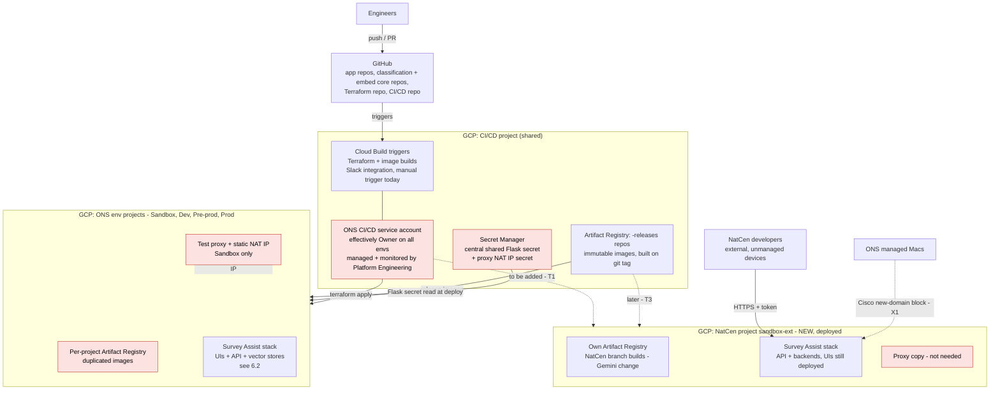
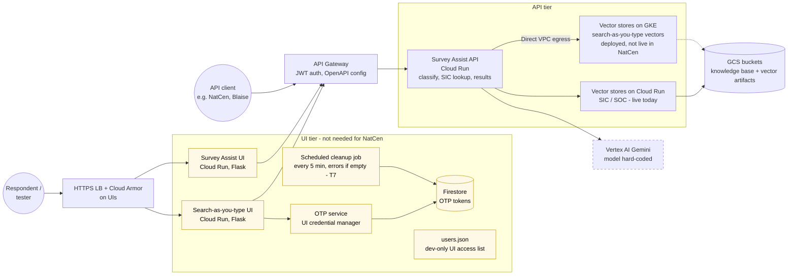
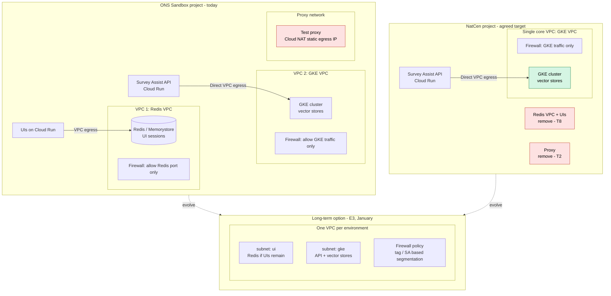
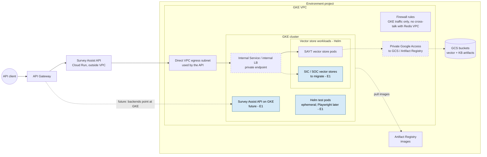
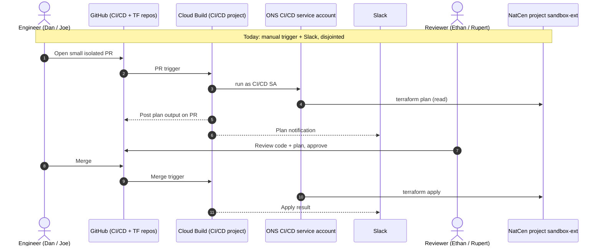
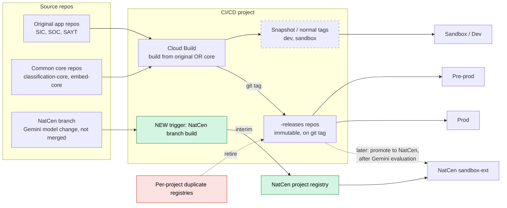
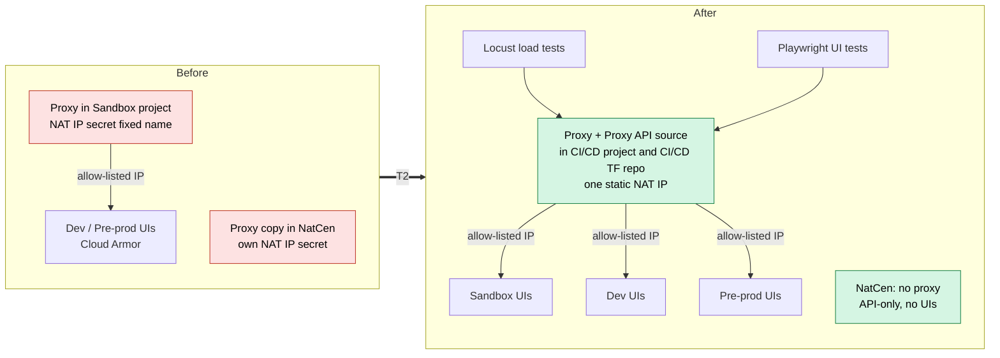
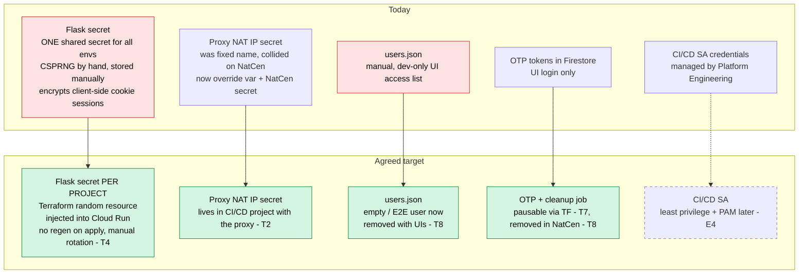
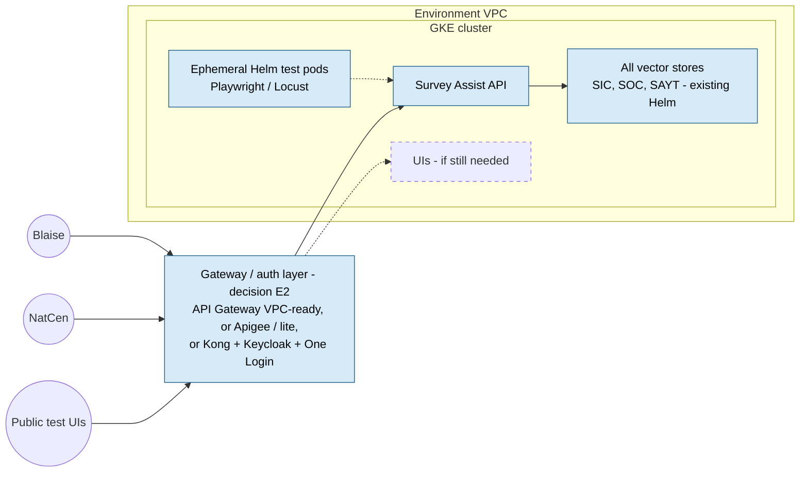
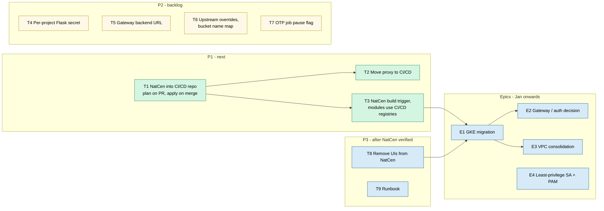

# Infra Sync (Survey Assist / NatCen): Meeting Summary

**Date:** Tuesday 27 Oct 2026
**Attendees:** Joe, Dan (NatCen environment deployment), Ethan (Survey Assist infra, original design history), Matt (lead, asked for this summary)
**Mentioned:** Steve (original Flask secret and `users.json` setup, on board with the GKE direction), Rupert (reviewer), Jeff, Dominic, Luke, "Mali" (helping with the Cisco ticket; name uncertain), ONS Platform Engineering, ONS Security, data science
**Companion docs:** [current-setup.md](current-setup.md), [proposed-setup.md](proposed-setup.md), [271026-NatcenSmokeTest-summary.md](271026-NatcenSmokeTest-summary.md)

> **About the transcript.** It's auto-generated, has no speaker labels, and is noisy. Who said what is inferred from context, so treat attributions as approximate. Corrections used throughout this document:
>
> | Transcript says | Means |
> |---|---|
> | NATSEN, NAPSAN, NetSend, NASM, NAT center | NatCen |
> | SAY, SAT UI | Survey Assist API |
> | DK, GP, GK, TG | GKE |
> | CACD, CRCD, CI CD | CI/CD |
> | Sares, Zerus, sterus, serious account | service account |
> | BPC, EPPC, Red SVC | VPC, Redis VPC |
> | Tyrone, cloud rooms, cloud front | Cloud Run |
> | locus | Locust (load testing) |
> | blaze | Blaise |
> | Apogee | Apigee |
> | CSpring | CSPRNG (secure random generator) |
> | manage max | ONS-managed Macs |
> | OMS / MHS | ONS / NHS |
> | bathroom | backlog |
> | "Germany 3.8 flash" | the replacement **Gemini** model (exact version unclear, probably a Gemini 3.x Flash) |
> | "QN stuff" | probably the GKE / Qwen vector store components (unclear) |
> | "forum theme flask secret" | the **shared Flask secret** (exact wording unclear) |

---

## 1. Summary for Matt

> **Infra sync, 27 Oct: outcome**
>
> The NatCen environment (`sandbox-ext`) is deployed. We went through the issues found while deploying it. Nothing blocks NatCen, and all fixes go in as small, isolated PRs.
>
> **Agreed, doing next (in this order):**
> 1. **Onboard the NatCen project into the CI/CD repo** so Terraform is plan-on-PR, reviewed, then apply-on-merge (replaces the manual trigger). *Main next ticket.*
> 2. **Move the test proxy out of the sandbox into the CI/CD project**, and remove it from the NatCen project. This supports the Locust and Playwright work. Separate ticket.
> 3. **Build once, deploy many:** add a NatCen build trigger in the CI/CD repo, and point Terraform at the CI/CD registries instead of per-project duplicates.
>
> **Backlog:** per-project Flask secret generated by Terraform (manual rotation only, rolled out to all envs as its own PR); remove the hard-coded API Gateway backend URL (to discuss on the ticket); bucket naming map; pause flag for the OTP cleanup job; remove the UI services from the NatCen project once it's verified.
>
> **Longer term:** move the vector stores and the API onto GKE, using NatCen as the first case (Steve is supportive). Decide on the gateway and auth approach soon because it affects Blaise. Revisit VPC consolidation in January.
>
> **Heads-up:** the ONS CI/CD service account effectively has Owner on all our environments. Platform Engineering monitors it closely, but Security may ask why it has access to the new project.
>
> **Split:** Dan leads the CI/CD onboarding and the proxy move. Joe pairs on those and takes the OTP job and naming PRs. Ethan and Rupert review. *(Proposed; Dan and Joe to confirm.)*

---

## 2. Meeting Outcome (TL;DR)

1. **NatCen environment is up.** The main changes needed to reach "deployment mode" are done. What remains is architectural items plus small fixes that only appeared because there are now **multiple sandboxes**, not one.
2. **Network:** there are **two core VPCs**: a **Redis VPC** (UIs only) and a **GKE VPC** (vector store backends). They're kept apart on purpose ("security through simplicity"). **NatCen needs only the GKE side** because it's API-only. Consolidating them is **deferred** until January, depending on how long the UIs live.
3. **Proxy:** it belongs in **CI/CD, not the sandbox**. NatCen doesn't need it. **Agreed to move it soon** to support Locust and Playwright.
4. **Terraform via PR:** the NatCen project gets **added to the CI/CD repo**, with plan output on PRs and apply on merge. **Top priority next.**
5. **Images:** they look duplicated because of the SIC/SOC "common core" refactor. **Agreed on build once, deploy many** through the CI/CD project's `-releases` registries. NatCen keeps its own registry and branch build for now.
6. **Flask secret:** move from a central shared secret to **per-project, Terraform-generated** secrets with **manual rotation only**. Do it as a **separate PR for all environments**.
7. **Small fixes:** bucket naming (override or map), OTP job pause flag, API Gateway backend URL, and `users.json` (an empty file is fine for now).
8. **Direction:** move toward **everything on GKE**, starting with NatCen (vector stores, then the API). The gateway and auth choice (API Gateway, Apigee, or Kong with Keycloak and One Login) is open. **Do the GKE refactor first** and change auth later.
9. **Cisco 403s:** caused by Cisco's **new-domain blocking** on ONS-managed devices. A ticket is raised. External, unmanaged devices can reach the API.
10. **Security heads-up:** the ONS CI/CD service account is effectively **Owner everywhere**. Platform Engineering accepts that because they monitor it. Moving to least privilege and PAM is needed before productionising.

---

## 3. Topic-by-Topic

Each topic covers the **question** (what was raised), the **response** (mostly Ethan, explaining history and design), and the **conclusion**. The **Ticket** column links to section 4.

### 3.1 Survey Assist API: VPC egress toggle

| | |
|---|---|
| **Question** | The Survey Assist API Cloud Run service now has a toggle that creates and attaches a VPC so it can egress. Why does it need one? |
| **Response** | Originally the API only talked to the **vector stores on Cloud Run**, so it needed no VPC. The **search-as-you-type vectors have moved into GKE**, so the API now needs **Direct VPC egress into the GKE VPC** to reach the internal backend in the cluster. That's the only reason. |
| **Context** | In NatCen the GKE components are deployed but **not live yet**. The API still calls the Cloud Run vector stores. |
| **Conclusion** | Makes sense. The VPC the API egresses through is the one that hosts GKE. No change needed. |
| **Ticket** | None (feeds into E1, the GKE refactor) |

### 3.2 Multiple VPCs and segmentation

| | |
|---|---|
| **Question** | There are several VPCs, and the design seems to segment each component into its own network. What's the reasoning, and does NatCen need all of them? |
| **Response** | Survey Assist started **fully serverless with no VPCs**. Two were added as needs grew: (1) a **Redis VPC** for the UIs, mainly search-as-you-type, also wired into the original Survey Assist UI for future use; (2) a **GKE VPC** for the vector store. They were kept separate for **security through simplicity**: strict firewall rules allow only Redis traffic in one and only GKE traffic in the other, so there's **zero cross-talk**. They could be identical; nothing forces two. A **third, loosely related network element is the proxy** (see 3.3). |
| **Discussion** | Separate VPCs can backfire by forcing services to be exposed when they don't need to be. Ethan agreed. The UIs' lifespan matters: after **January's public test** the focus moves to **Blaise** (API only), so the UIs become less important. If more UI testing rounds are needed, that's the time to tidy up the architecture. |
| **Conclusion** | **Only two VPCs are core.** **NatCen should only need the GKE side** (Survey Assist API and backends, no UIs, so no Redis). Consolidating into one VPC or subnets is a **long-term item**, to revisit around January. |
| **Ticket** | E3 (long term); T8 (remove UI resources from NatCen) |

### 3.3 Test proxy: where it lives

| | |
|---|---|
| **Question** | The proxy's NAT IP secret had a hard-coded name, so deploying NatCen failed with "resource exists". Fixed with a variable (old name as default, overridden for NatCen), which created a new secret for NatCen. **Does NatCen need the proxy at all?** |
| **Response** | The proxy's main purpose is to **flex the UIs** (load and functional testing). It indirectly controls some API interfaces because the UIs call them. It was built in the **sandbox in experimentation mode** before the last public test, and there was no time to move it into CI/CD. The NatCen copy was deployed in isolation and **isn't needed**, because nothing in NatCen uses the proxy to reach dev or pre-prod. |
| **Proposal** | **Centralise the proxy in the CI/CD project** so it controls all testing: the three default service projects plus any future NatCen ones. Also move the **Proxy API source code into the CI/CD Terraform repo**, so deployment and testing control live in one place instead of three. |
| **Timing** | Locust tests are ramping up and Playwright is expanding, so **do it sooner rather than later**, before environments scale down. Everyone agreed. |
| **Conclusion** | **Agreed.** Move the proxy to CI/CD and remove it from both the sandbox and NatCen projects. Kept as a **separate ticket** from the CI/CD onboarding (3.13), but in the same repo. Ethan will keep an eye on it. |
| **Ticket** | **T2** (P1); T6 (merge the secret-name fix) |

### 3.4 Shared Flask secret

| | |
|---|---|
| **Question** | There's a single shared Flask secret across environments. Was that deliberate? Should it be per project? |
| **Response** | It was raised before the public test. The secret encrypts **client-side cookie sessions** in Flask (the original setup, before Redis). The argument for centralising it was that it could be **revoked everywhere from one place**, and it was accepted for a two-week public trial by the team and Security. The counter-argument: **anyone who can access it can access every environment**. Steve generated it independently with a CSPRNG and stored it manually in Secret Manager. |
| **Agreed design** | Make it **project-specific**, and **generate it in Terraform** (a random resource) injected straight into the Cloud Run service, instead of baking it into the app. **Don't auto-regenerate** on plan or apply, because that would log out every user instantly. Rotate only by **deliberate manual action**. |
| **Note** | It matters less now that **Redis sessions** don't use it, but keeping it consistent is good in case it's needed again. |
| **Conclusion** | **Agreed.** Matt asked for it as a **separate PR** so the change goes back into **all services and environments**, not just NatCen. The plan is that every change goes in its own isolated PR. |
| **Ticket** | **T4** (P2) |

### 3.5 Image tags, repos and duplicated images

| | |
|---|---|
| **Question** | Image tags don't match between the pipeline and Terraform. The vector store and SIC services use the **same image**, but the pipeline splits them across multiple repos. Should Terraform be updated to match CI/CD? |
| **Response (history)** | Survey Assist started as **SIC only**. From January to March this year, **SOC** (occupation) classification was added. SIC and SOC turned out to share most of their logic; only the LLM prompts and vector store knowledge base and embeddings differ. A **refactor around June** created **common core repos** (something like `survey-assist-embed-core` and `survey-assist-classification-core`; Matt and Jeff will know the exact names) that build one consistent image, with the knowledge base swapped dynamically. That's why images look identical. **Search-as-you-type has its own Artifact Registry** because that public test was decided in the middle of the refactor. **Cloud Build can build from either the original repos or the common core.** |
| **Conclusion** | The duplication is explained, and Cloud Build handles it. Rolled into 3.6. |
| **Ticket** | T3 |

### 3.6 Build once, deploy many

| | |
|---|---|
| **Question** | Can we build an image once and deploy it many times, instead of keeping duplicate registries in each project? |
| **Response** | Yes, via the **CI/CD repo**. The CI/CD project already has Artifact Registry repos with a **`-releases` suffix**. A **git tag** in an app repo triggers an **immutable build** that's stored in the CI/CD project and used from dev upward (pre-prod and prod). Non-release builds use snapshot or normal tags. |
| **NatCen wrinkle** | NatCen is meant to *consume* Survey Assist unchanged, a kind of "promote to NatCen" like promote to pre-prod. But the **Gemini model change** means NatCen needs its own builds for now. |
| **Agreed approach** | Add a **Cloud Build trigger in the CI/CD repo** that builds from the **NatCen branch** (not merged to main) and deploys into the NatCen sandbox. The NatCen project **keeps its own registry for now**. Later it **pulls the shared immutable image** with no rebuild. The work: copy and version the repos, then update the modules to reference the CI/CD ones. "Should be very quick." |
| **Gemini dependency** | The new model **hasn't been evaluated**. That's fine in the **sandbox** because NatCen isn't allowed to send real data. **Before real data goes through, NatCen must flag it** and the evaluation question has to be resolved. NatCen still uses the `classify` endpoint. |
| **Conclusion** | **Agreed.** |
| **Ticket** | **T3** (P1) |

### 3.7 Bucket name length

| | |
|---|---|
| **Question** | Bucket names are built from the project ID, and the longer NatCen ID breaks the 63-character limit. Does `sandbox-ext` fit? |
| **Response** | Two options are both fine. (a) **Coalesce**: keep the current name as the default and allow an override variable. This is what was done for NatCen. (b) A **map at the Terraform level** with predefined names per environment, extended as environments are added. This needs a storage module change. One will be needed again when the **NatCen prod environment** arrives. |
| **Context** | The buckets hold **knowledge base and vector store artifacts** for the Cloud Run services. The sandbox bucket is messy with experimental work. |
| **Conclusion** | The current fix is fine. Consider the map approach. **Backlog.** |
| **Ticket** | T6 (P2) |

### 3.8 OTP cleanup scheduled job

| | |
|---|---|
| **Question** | A scheduled job runs **every 5 minutes** and **errors if there are no tokens**. Is it needed in NatCen? |
| **Response** | The **OTP service** is the credential manager **for the UIs only**. The job is a **second line of defence**: the code already checks creation date and expiry, and the job deletes expired tokens so they can never be reused. It errors when empty because during the live public test it doubled as **monitoring**, to detect if the database was wiped. That was arguably too cautious. NatCen doesn't use OTP, so the job **can be paused**. Dan has already paused it manually. |
| **Agreed** | Make a small refactor to the **Firestore OTP module**: add an **optional pause flag** (the Cloud Scheduler Terraform resource has a paused state), and consider a **frequency variable** (5 minutes may be too often; once a day was discussed). It would also be nice to log a warning instead of an error. Non-critical. |
| **Conclusion** | **Backlog, low priority.** This is the same "job fails on fresh deploys with no data" issue from the smoke-test meeting, which Joe may pick up. |
| **Ticket** | **T7** (P2) |

### 3.9 Terraform contention and Ethan's roadmap

| | |
|---|---|
| **Question (Matt)** | With three engineers on Terraform, are other big changes coming that could block each other? |
| **Response** | **Nothing major between now and January.** The next big piece is **logging and monitoring before January**, mostly on the edges with few resource changes. |
| **Conclusion** | Low risk of collisions. Small isolated PRs continue. |

### 3.10 Longer-term direction: everything on GKE

| | |
|---|---|
| **Response (Ethan)** | Moving the vector store to GKE showed its benefits. At Monday's internal catch-up, Steve and others discussed **running all services on GKE**, including the UIs. The **Helm test suite** built for the vector store could expand to include **Playwright**, with **ephemeral test pods in the cluster**, which makes many of the CI/CD testing concerns go away. |
| **Proposal** | Use **NatCen as the starting point**. (1) Bring **all vector stores into GKE** (mostly possible with the existing Helm charts). (2) Bring the **Survey Assist API into GKE**. (3) First demonstration: keep **API Gateway** as the authentication entry point, but point its **backends at GKE**. This also serves **Blaise**, which is API-only, and **future public tests**. |
| **Agreement** | Cloud Run isn't fully inside the VPC even with egress, so running workloads in Kubernetes is **more secure**, scales better and costs less. The gateway may need **re-provisioning to work with the VPC and GKE**, fronting the APIs with upstream services defined. |
| **Conclusion** | **Agreed direction.** Steve was on board on Monday. It's the next major piece after the NatCen setup. |
| **Ticket** | E1 (epic) |

### 3.11 API gateway choice and authentication

| | |
|---|---|
| **Question** | Is API Gateway the right long-term product? A decision is needed **soon** because it locks things in for **Blaise**. |
| **Response** | API Gateway was chosen because it was **easy to develop with** and **wasn't Apigee** (full Apigee is heavy). Google now offers an Apigee lite option, which nobody has tried. There are open questions about whether it's approved for government services. **Blaise auth concern:** clients must generate **signed JWTs**, which isn't within Blaise's remit, and the adapter proof of concept looks "janky". |
| **Alternatives raised** | **Kong with Keycloak** integrated with **GOV.UK One Login**. NatCen uses `.ac.uk` domains, so they're probably one step removed from central government and One Login may not suit them. ONS reportedly uses **Azure Application Gateway / API management** for login. The NHS has a central team that manages the gateway and adds routes on request. It may be worth a wider ONS discussion. |
| **API Gateway in Terraform** | Usable but **fiddly**. Terraform gets dependency ordering wrong on destroy or change, and Google sometimes changes the manifest behind the scenes, which knocks state out of sync. That suggests Google isn't maintaining it well and is pushing people to Apigee. Syncing schemas is solvable because every app already has an OpenAPI spec. |
| **Conclusion** | **Do the GKE refactor first. Change authentication later if and when needed.** Don't change everything at once. |
| **Ticket** | E2 (spike / decision) |

### 3.12 API Gateway backend URL hard-coded

| | |
|---|---|
| **Question** | The backend (Cloud Run) URL appears to be hard-coded in the services or gateway config instead of coming from the deployment. On first provisioning, the config pointed at the **wrong URL**, so Dan had to provision the gateway, then create a **new config version** by hand. |
| **Response** | **Nothing in the API spec should hard-code a backend.** If it does, refactor it into a variable. Ethan was not convinced it's hard-coded and asked to discuss it on the ticket. |
| **Conclusion** | Raise a ticket with specifics and **discuss before fixing**. |
| **Ticket** | **T5** (P2) |

### 3.13 `users.json` manual provisioning

| | |
|---|---|
| **Question** | How is `users.json` created and changed? Is it automated? |
| **Response** | It's **development only** and isn't used in any live service. It controls UI access during development. Steve set it up manually as part of UI setup. It's not needed once the UIs move to tokens. An **empty file works**. |
| **Current state** | Dan created one with a **single end-to-end test user** for NatCen. Pre-prod's was also created manually. |
| **Follow-up** | Once the NatCen deployment is verified as-is, **tear down the UI services** in the NatCen project because they aren't needed and are just more to manage. Cloud Run is cheap, especially with minimum instances set to zero, but still. Then `users.json` isn't needed at all. |
| **Conclusion** | An empty or minimal file is fine for now. Remove the UIs later. |
| **Ticket** | **T8** (P3), T9 (document it) |

### 3.14 Cisco blocking on ONS-managed Macs (the 403s)

| | |
|---|---|
| **Question** | Managed Macs can't reach the API Gateway (raised in chat this morning). Did any environment need infra changes for managed devices? |
| **Response** | **No infra changes were ever needed.** A **Cisco security rule** blocks domains it sees for the first time (newly seen domains). ONS enabled **new-domain blocking**, which is sensible against typo-squatted spoof sites. The older environments' domains have existed for years, so they aren't caught. The original team (Steve, Dominic, Luke, possibly Matt) also had managed MacBooks early and likely got exceptions while in development mode. The team also used off-network devices for a while. |
| **Conclusion** | Not an infra issue. The ticket that's been raised ("Mali" helping) should unblock it. Dan showed that **external, unmanaged devices can access the API**, which is good news for NatCen. |
| **Ticket** | X1 (track only) |

### 3.15 Terraform through a PR pipeline (ways of working)

| | |
|---|---|
| **Question** | Can the whole Terraform flow run in the pipeline through PRs? Today it's **disjointed**: Slack integration plus a manual trigger. Wanted: a PR is raised, the **plan output is posted on the PR**, the reviewer checks the plan, and **apply runs on merge**. |
| **Response** | The first step is to **add the sandbox-external (NatCen) project into the CI/CD repo setup**, so it picks up the repos and plans and applies as needed. The **Slack side is already set up**. It's mainly a **project-level grant** so the main CI/CD service account can access the external sandbox project. |
| **Priority** | Matt asked whether this beats other work. Yes: it's **"the main ticket to work on next"**. It gives a fast, repeatable pipeline with review from Ethan, Rupert and the team. It's **separate from the proxy ticket**, but both live in the CI/CD repo, and either can go first. |
| **Ownership** | Dan and Joe pick it up. Ethan (or Rupert) reviews. |
| **Ticket** | **T1** (P1) |

### 3.16 ONS CI/CD service account permissions (heads-up)

| | |
|---|---|
| **Info (Ethan)** | The CI/CD service account is **fully managed by ONS Platform Engineering** and is **heavily over-permissioned**: effectively the **Owner role in all our environments**. Ethan raised this about a year ago. Platform Engineering's answer: it's in a subset of service accounts whose usage and **token creation they monitor extensively**, so they accept it. |
| **Implication** | When it's granted access to the NatCen project, **ONS Security may ask why**. The answer is that it's the original setup. |
| **History** | About six months ago (between the two public tests), a refactor to **least-privilege service accounts**, CSP service accounts, and user access with **PAM** was close to approval, but was dropped for the search-as-you-type test. For **productionising**, this has to come back. |
| **Conclusion** | Noted. Enough to proceed now. Least privilege is a separate, future conversation. |
| **Ticket** | E4 (later) |

### 3.17 Close

- Matt: **Joe and Dan to send a quick summary or follow-up chat** with the actions and **how the work is split** between them (section 1 covers this).
- Ethan: will watch the **CI/CD integration** and the **proxy migration**.
- If there's a pause after the NatCen setup, use it to **move the proxy** (remove it from NatCen and sandbox, put it in CI/CD) to enable Playwright and Locust.

---

## 4. Tickets to Create (Prioritised)

**Priority key:** **P1** = agreed to do next · **P2** = backlog, near term · **P3** = after NatCen is verified · **Epic** = longer term or needs a decision · **Track** = owned elsewhere.
**Rule agreed in the meeting:** every change goes in its **own isolated PR**, and is backward-compatible (no change for existing environments).

| ID | Pri | Title (suggested Jira) | Type | Repo / area | Owner (proposed) | Source |
|---|---|---|---|---|---|---|
| **T1** | **P1** | Onboard NatCen `sandbox-ext` project into CI/CD repo: plan on PR, apply on merge | Task | CI/CD repo, IAM | Dan lead, Joe pair; reviewers Ethan/Rupert | 3.15 |
| **T2** | **P1** | Move test proxy (Proxy API and Terraform) into CI/CD project; remove from sandbox and NatCen | Task | CI/CD repo, sandbox TF | Dan / Joe; Ethan watching | 3.3 |
| **T3** | **P1** | Build once, deploy many: NatCen branch build trigger in CI/CD; modules reference CI/CD registries | Task | CI/CD repo, TF modules | Dan / Joe | 3.5, 3.6 |
| **T4** | P2 | Per-project Flask secret generated by Terraform, manual rotation only; roll out to all envs | Task | TF modules (Cloud Run, Secret Manager) | TBC | 3.4 |
| **T5** | P2 | Investigate and remove hard-coded API Gateway backend URL; make it a variable | Bug / spike | API Gateway TF, OpenAPI spec | Dan (discuss with Ethan first) | 3.12 |
| **T6** | P2 | Upstream NatCen fixes as isolated no-op PRs: NAT IP secret-name override, bucket-name override; consider a bucket-name map | Task | TF modules (secret, storage) | Joe | 3.3, 3.7 |
| **T7** | P2 | OTP cleanup job: `paused` flag and schedule variable; warn instead of error when no tokens | Task | Firestore OTP module, job code | Joe | 3.8 |
| **T8** | P3 | Remove UI services (and Redis VPC, OTP, `users.json`) from NatCen project after verification | Task | NatCen env TF | TBC | 3.2, 3.13 |
| **T9** | P3 | Runbook: NatCen manual steps (`users.json`, scheduler pause, gateway config re-version, secret overrides) | Task | Confluence | Dan / Joe | 3.8, 3.12, 3.13 |
| **E1** | Epic | Migrate workloads to GKE: vector stores, then API; gateway backends to GKE; Helm tests incl. Playwright | Epic | Helm, TF, CI/CD | Ethan / Steve / team | 3.10 |
| **E2** | Epic | Decide API gateway and auth approach (API Gateway vs Apigee/lite vs Kong, Keycloak, One Login); Blaise JWT | Spike | Architecture | Matt / Ethan | 3.11 |
| **E3** | Epic | Revisit VPC design: consolidate Redis and GKE VPCs into one VPC with subnets (January, depends on UI longevity) | Spike | Network | Team | 3.2 |
| **E4** | Epic | Least-privilege service accounts and PAM with ONS Platform Engineering (before productionising) | Epic | IAM / security | Matt / Ethan | 3.16 |
| X1 | Track | Cisco new-domain block on managed devices | External | ONS IT | "Mali" (already raised) | 3.14 |
| X2 | Track | Gemini model evaluation before NatCen sends real data | External | Data science | Data science | 3.6 |
| X3 | Track | Logging and monitoring before January | Info | Survey Assist | Ethan's team | 3.9 |

### 4.1 Ticket detail and acceptance criteria

**T1: Onboard NatCen project into the CI/CD repo (P1)**
- Add `sandbox-ext` as a target in the CI/CD repo workflows (Cloud Build triggers).
- Grant the ONS CI/CD service account access at project level (expect Security questions; see 3.16).
- On PR: run `terraform plan` and post the output on the PR and in Slack (Slack integration already exists).
- On merge: `terraform apply`. Remove the need for the manual trigger.
- **Done when:** a no-op PR shows a clean plan for NatCen, and merging applies with no manual step.

**T2: Move the test proxy to the CI/CD project (P1)**
- Move the Proxy API source code into the CI/CD Terraform repo, and deploy the proxy and its static NAT IP in the CI/CD project.
- Point the dev, pre-prod and sandbox Cloud Armor allow-lists at the CI/CD proxy IP.
- Remove the proxy from the sandbox and NatCen projects.
- **Done when:** Locust and Playwright runs go through the CI/CD proxy and no environment project hosts a proxy.

**T3: Build once, deploy many (P1)**
- Add a Cloud Build trigger in the CI/CD repo that builds from the NatCen branch into the NatCen registry (interim).
- Update the Terraform modules to reference the CI/CD project registries, with release images coming from the `-releases` repos on git tag.
- **Done when:** NatCen deploys from a CI/CD-built image. Plan for NatCen to later consume `-releases` images once the Gemini change is merged and evaluated.

**T4: Per-project Flask secret (P2)**
- Generate it with a Terraform random resource per project, store it in that project's Secret Manager, and inject it into Cloud Run.
- **No regeneration on plan or apply.** Rotate only deliberately (for example a `-replace` target or a keeper variable), documented in the runbook.
- Separate PR. Roll out to sandbox, dev, pre-prod, prod and NatCen. Retire the central secret once all environments have moved.

**T5: API Gateway backend URL (P2)**
- Find where the backend URL is fixed (gateway OpenAPI config vs service code).
- Make it a variable that takes the Cloud Run URL from Terraform outputs, so the first apply creates a correct config with no manual re-version.
- Discuss on the ticket with Ethan before changing anything.

**T6: Upstream the NatCen fixes (P2)**
- NAT IP secret name: an override variable whose default is the current name. Already used in the NatCen branch.
- Bucket names: a `coalesce` override (done) or a predefined name map per environment. Needed again for the NatCen prod environment.
- **Done when:** each is merged to `main` as a separate PR with a "No changes" plan for existing environments.

**T7: OTP cleanup job (P2)**
- Add a `paused` variable (default `false`) and a schedule variable (default the current 5 minutes) to the Firestore OTP module.
- Job code: log a warning instead of raising an error when there are no tokens. Keep alerting on a genuine database failure if it's still wanted.
- Set NatCen to paused through Terraform instead of the manual pause.

**T8: Remove UIs from NatCen (P3)**
- After the as-is deployment is verified, remove the UI Cloud Run services, the Redis VPC and Redis instance, the OTP service and job, and `users.json` from NatCen.

---

## 5. Proposed Split for Dan and Joe (to confirm)

| Person | Takes | Why |
|---|---|---|
| Dan | T1 lead, T2 lead, T3, T5 | Owns the NatCen deployment and knows the CI/CD flow and the gateway issue |
| Joe | Pair on T1 and T2, then T6 and T7, plus T9 runbook | Smaller self-contained PRs. T7 is the job fix flagged for Joe in the smoke-test meeting |
| Ethan / Rupert | Review T1 to T4 | Agreed in the meeting |
| Unassigned | T4, T8 | Pick up after the P1 items |

---

## 6. Diagrams

> **Legend:** solid = stated in this meeting or earlier ones · dashed = inferred, needs confirming · red = problem or to be removed · green = agreed change · blue = longer-term direction.

### 6.1 Estate overview: how everything fits together today

**In words:** engineers work in GitHub. Cloud Build in the shared CI/CD project runs Terraform and image builds as the ONS CI/CD service account, which can reach every environment. Each environment project runs the Survey Assist stack. The sandbox also hosts the test proxy. NatCen is a new project with its own registry and branch builds, and it isn't yet wired into the CI/CD repo.

### 6.2 One environment's application stack (what the services are)

### 6.3 VPC structure: ONS sandbox today vs agreed NatCen layout

**Key point:** the two VPCs are isolated so the UI tier (Redis) and backend tier (GKE) can't talk to each other at all. NatCen is API-only, so it only needs the GKE VPC. The proxy doesn't belong in any environment project.

### 6.4 GKE setup inside the VPC (as understood)

### 6.5 CI/CD: Terraform flow (agreed, T1)

### 6.6 CI/CD: image build once, deploy many (agreed, T3)

### 6.7 Testing and proxy: before and after (agreed, T2)

### 6.8 Secrets: what they are and where they should live

| Secret | What it's for | Today | Target | Ticket |
|---|---|---|---|---|
| Flask secret key | Encrypting client-side cookie sessions in the Flask UIs (less critical now with Redis sessions) | One shared secret for all environments, generated by hand | Per project, generated by Terraform, rotated only by deliberate manual action | T4 |
| Proxy NAT IP secret | Lets dev and pre-prod Cloud Armor allow-list the proxy's static egress IP | Fixed name; override variable added for NatCen | Lives with the proxy in the CI/CD project; NatCen has none | T2, T6 |
| `users.json` | Dev-only list of who can use the UIs | Created by hand per environment | Empty or a single E2E user now; removed with the UIs in NatCen | T8, T9 |
| OTP tokens | UI one-time login tokens in Firestore | Cleanup job every 5 minutes | Pausable or configurable through Terraform; not deployed in NatCen | T7, T8 |
| CI/CD service account | Runs Terraform and builds | Effectively Owner everywhere, monitored by Platform Engineering | Least privilege and PAM before productionising | E4 |

### 6.9 Long-term direction: GKE-first (E1, E2)

**Sequence agreed:** NatCen first (vector stores, then the API into GKE, then gateway backends pointed at GKE), then reuse that for future public tests and Blaise. Auth changes come **after** the GKE refactor, not at the same time.

### 6.10 Ticket roadmap

---

## 7. What This Meeting Confirmed or Corrected (vs earlier notes)

| Earlier assumption ([current-setup.md](current-setup.md) / [proposed-setup.md](proposed-setup.md)) | Now known |
|---|---|
| "One VPC per service" | **Two core VPCs** (Redis for UIs, GKE for vector stores), plus the proxy's network in the sandbox. Kept separate deliberately for isolation. |
| Where does Kubernetes fit? | **GKE hosts the vector stores** (search-as-you-type vectors, deployed with Helm). The API reaches it through Direct VPC egress. Plan is to move more onto GKE. |
| Is the gateway API Gateway or Apigee? | **GCP API Gateway**, chosen for simplicity. Its future is an open decision (E2). |
| Proxy role | **Flexes the UIs** for load and functional testing. **Moving to the CI/CD project.** |
| Images rebuilt per environment | Partly true. The CI/CD `-releases` repos already give **immutable builds from dev upward**. The apparent duplication comes from the SIC/SOC common-core refactor. |
| Default Cloud Build SA with broad rights | It's the **ONS CI/CD service account**, managed by **Platform Engineering**, effectively Owner everywhere, **accepted because it's monitored**. |
| 403 on NatCen from ONS | **Cisco new-domain blocking** on ONS-managed devices. External devices work. |
| Job failing on fresh deploys | It's the **OTP cleanup job**: UI-only, paused in NatCen, pause flag ticketed (T7). |

---

## 8. Things I'd Flag (my analysis, not said in the meeting)

1. **API Gateway and private GKE backends.** GCP API Gateway is serverless and can't route into a VPC directly, so backends must be publicly reachable. "Point the gateway backends at GKE" therefore probably needs an **external or authenticated GKE ingress**, which undoes some of the security benefit, or a different gateway that supports private backends (Apigee via Private Service Connect, or an in-cluster gateway). Raise this early in E1 and E2 because it may decide the gateway question.
2. **Flask secret rotation mechanism.** If T4 uses `random_password` / `random_bytes`, rotation means `terraform apply -replace=...`. Document it in the runbook, and add a `keepers` variable so rotation can be triggered intentionally through a PR, which keeps it auditable. Also check the value isn't printed in plan output, and remember Terraform state will hold it in plain text, so state bucket access matters.
3. **Granting the CI/CD service account (Owner-level) access to the NatCen project.** NatCen is an external consumer's environment. Ask Platform Engineering whether a narrower grant is possible for this one project, since it's new. At least record the decision so the answer is ready when Security asks.
4. **Moving the proxy (T2) changes the source IP that dev and pre-prod Cloud Armor allow.** Sequence it: deploy the new proxy, add its IP to the allow-lists, switch the tests over, then remove the old proxy. Otherwise testing breaks between steps.
5. **NatCen and Gemini.** The meeting agreed "no real data until flagged". Make sure **NatCen are told in writing** at Thursday's handover that classify uses an **unevaluated model** and sandbox only. That links to the smoke-test meeting's concerns.
6. **Keep the as-is verification first.** T8 (removing UIs) changes the environment NatCen is about to use. Only do it after Thursday's handover and smoke tests pass, and re-run the Postman smoke tests afterwards.
7. **NatCen prod environment** was mentioned in passing ("the prod environment for the external solution"). If one is coming, T1, T3 and the bucket naming map (T6) should be designed with it in mind now.

---

## 9. Open Questions

1. When is the **NatCen prod environment** expected, and is it a new project?
2. Which **project holds the shared Flask secret** and the proxy NAT IP secret today (the CI/CD project?)
3. Exact **common-core repo names** (ask Matt or Jeff).
4. Who owns **T4 (Flask secret)**, given it affects every environment?
5. Is the **"Apigee lite" option** approved for government use, and who decides the gateway (E2): Matt, Ethan, or wider ONS?
6. What does the Survey Assist API use to **store results** (Firestore?), and does NatCen need it? Not discussed, but relevant to T8.
7. Does the **Cisco ticket** (X1) cover all ONS-managed devices, and is there an ETA?
