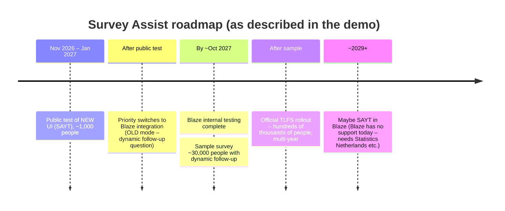
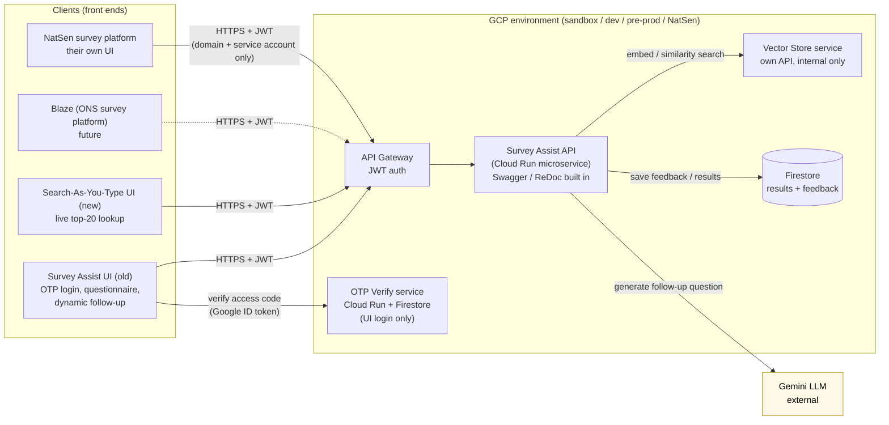
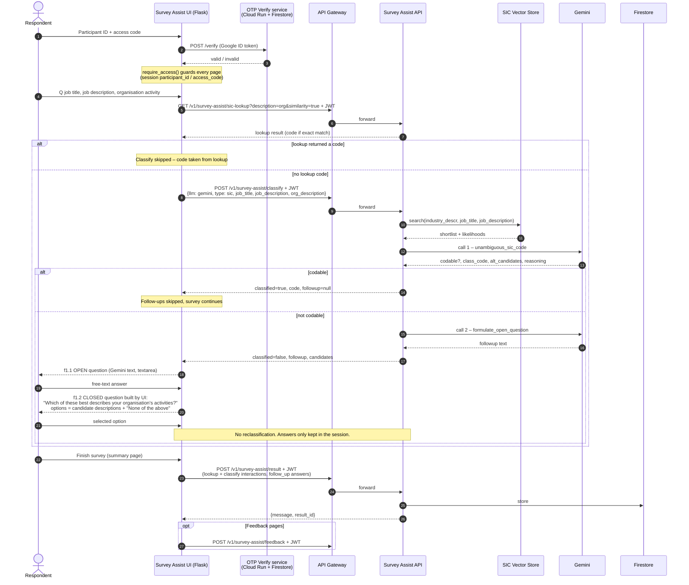
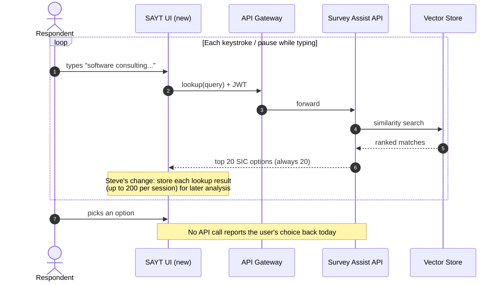
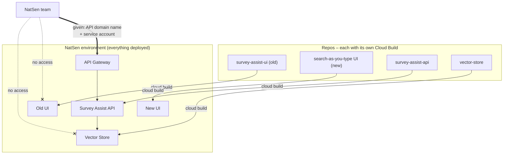
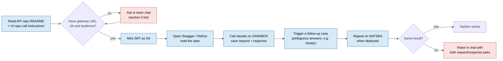

# App Demo Summary – Survey Assist (UIs, API, Vector Store, LLM)

**Date:** 2026-10-22
**Source:** `app-demo.txt` (auto-transcript – speakers not labelled; some names/terms are transcription guesses)
**People referenced:** Joe (you), Dan (sent the invite, joined late), Jeff, Matt (answered the NatSen/Blaze questions), Steve (recent search-as-you-type changes), James. The presenter who demoed the UIs was not named in the transcript, but it was probably Jeff.
**Companion docs:** `tech-meeting-summary.md`, `current-setup.md`, `proposed-setup.md` (platform/infra side)

> **Transcription fixes assumed in this doc**
> - "SIP coding" / "SIP classification" = **SIC** (Standard Industrial Classification) coding.
> - "TLFS" / "TRFS" = **TLFS** (Transformed Labour Force Survey).
> - "NATSEN" / "Matsen" / "NATSEnder" = **NatSen** (the downstream consumer environment from the tech meeting; probably NatCen).
> - "Searchity Type" / "SitchyType" = **Search-As-You-Type (SAYT)**.
> - "redox" = **ReDoc**; "API screamer" = **API schema**.
>
> **How to read the diagrams**
> - Solid boxes and lines = **stated** in the meeting.
> - Dashed boxes and lines = **inferred** (a reasonable assumption that needs confirming).
> - Red boxes = **problem or gap** seen in the demo.

---

## 1. TL;DR

- The demo walked through the **two Survey Assist front ends** and how they call the backend:
  1. **Survey Assist UI (old UI).** It asks the survey questions, then uses the **classify API**. When the API can't settle on a SIC code, it uses an **LLM (Gemini) to generate a dynamic follow-up question**. This is the flow that **Blaze** and **NatSen** care about.
  2. **Search-As-You-Type UI (new UI).** As the user types, it calls the API and always shows the **top 20** SIC matches. There is no LLM in this flow at the moment.
- **Backend chain:** Client → **API Gateway (JWT auth)** → **Survey Assist API** → **Vector Store** service (+ **Gemini** as an external call). The **Survey Assist API is the only API anyone outside the system touches**.
- **Every component deploys on its own**, each with its own **Cloud Build**.
- **NatSen** will build its **own UI** on its own survey platform. It will get **only the API domain name and a service account**.
- **Your task for this afternoon:** follow the instructions in the **Survey Assist API repo**, which is still public. The **UI repo has better instructions**, and someone will send you the link. Connect to the **existing sandbox API** and **make a couple of calls**. Later, run the same calls against **NatSen**. If both return the same results, the NatSen deployment works.

---

## 2. Action items

### 2.1 For you (Joe)

| # | Action | When | Notes |
|---|---|---|---|
| J-1 | Follow the **Survey Assist API repo** instructions and connect to the **existing (sandbox) API** | **This afternoon** | You don't need extra Git access. The repo is public for now and will be made **internal**, but you will still be able to see it with your Git account. |
| J-2 | **Make a couple of API calls** (classify and the follow-up flow) and check the responses make sense | This afternoon | Sandbox shows how the API is supposed to behave. Use it as your baseline. |
| J-3 | Look at the **UI repo's instructions** for calling the API | When the link arrives | The presenter said the UI repo explains how to call the API better than the API repo does. |
| J-4 | Open the **Swagger / ReDoc** page to read the API spec | After auth works | It is built into the container image and sits **behind the API Gateway**, so you need a **JWT** to see it. |
| J-5 | Later: run the **same calls against NatSen** and compare them with sandbox | Once NatSen is up | Same results mean it's working. |
| J-6 | Post blockers or questions in the **team chat** | Ongoing | Follow-ups can happen **tomorrow or Monday**. |

### 2.2 For others (things you are waiting on)

| # | Owner | Promised item |
|---|---|---|
| O-1 | Presenter | Message in the team chat with **all links**: the screenshot walkthrough doc, the API docs, and "other useful stuff" |
| O-2 | Presenter | The **specific endpoints the old UI uses**, since those are what NatSen will integrate with |
| O-3 | Presenter | A pointer to the **UI repo's API-calling instructions** |
| O-4 | Team / data people | Decide the **open vs closed follow-up question** strategy. Engineering will be told the outcome and doesn't need to choose. |
| O-5 | Team | Decide whether NatSen should **send results back** (optional, probably not needed). Also decide **what to log** (data protection, cost). |

---

## 3. What to ask for so you can run the test today

You can't get a JWT without the auth details, and the call will fail without one. Ask for these items **in one message in the team chat** so you aren't blocked:

**Repos and docs**
1. Links to the repos: **survey-assist-api**, **survey-assist-ui** (old), **search-as-you-type UI** (new), and **vector-store**.
2. The **screenshot walkthrough doc** (which question feeds SIC coding, and what happens at each step).
3. The **list of endpoints the old UI calls** (O-2), with **example request/response payloads** if possible.

**Environment and auth**
4. The **sandbox API Gateway base URL** (domain), plus the **NatSen** one when it exists.
5. The **service account** to authenticate as, and **how to mint the JWT**:
   - Can you **impersonate** the SA (`roles/iam.serviceAccountTokenCreator` on it)? Or are you meant to use a **key file**? Impersonation is safer, so prefer it.
   - The expected **JWT audience (`aud`)** and **issuer** that the API Gateway config checks.
6. The **GCP project access** you need in sandbox (at minimum, permission to sign tokens for that SA).
7. The **Swagger/ReDoc path**, e.g. `/docs` or `/redoc`. This is not confirmed.

**Sanity and safety**
8. Any **rate limits or cost concerns**. The classify call can trigger **Gemini**, which costs money per call.
9. Whether the sandbox data is **safe test data**. Don't send real personal data in free-text answers.
10. Whether the **NatSen environment is deployed** yet. Per the tech meeting, it is still a work in progress.

### 3.1 How the token is actually generated (confirmed from `survey-assist-utils`)

Source: `/Users/joebadmus/my_ons.nosync/survey-assist-utils`, specifically `src/survey_assist_utils/api_token/jwt_utils.py`, the `README.md` and `scripts/volume_testing/volume_test.py`.

**Mechanism:**
- You log in with **your own Google account** using Application Default Credentials (ADC). You don't need a key file.
- The tool calls the **IAM Credentials `signJwt` API** to sign a JWT **as the API service account**.
- The claims are `iss = sub = email = SA_EMAIL`, `aud = API_GATEWAY`, and expiry defaults to 1 hour.
- The API Gateway checks `x-google-issuer = SA_EMAIL`, `x-google-audiences = audience`, and uses the SA's public keys (JWKS).

**What this means you need:**
1. The **GCP project ID** for sandbox. It's used as the ADC quota project.
2. **`SA_EMAIL`**: the API-access service account.
3. **`API_GATEWAY`**: the gateway host.
4. **`roles/iam.serviceAccountTokenCreator`** on that service account, granted to **your user**. Without it, `signJwt` returns **403**.
5. The **IAM Credentials API** enabled in the quota project. It probably already is.

**Steps (from the README):**

```bash
cd /Users/joebadmus/my_ons.nosync/survey-assist-utils
python3.12 -m venv .venv && source .venv/bin/activate
poetry install

unset GOOGLE_APPLICATION_CREDENTIALS        # README has a typo: GOODLE_...
gcloud auth application-default login
gcloud auth application-default set-quota-project <SANDBOX-PROJECT-ID>

export SA_EMAIL="<api-access-sa>@<project>.iam.gserviceaccount.com"
export API_GATEWAY="<gateway-host>"         # see audience caveat below

make generate-api-token                     # or: poetry run generate-api-token -e 7200
```

**First classify call.** The endpoint and payload come from `volume_test.py`:

```bash
TOKEN="<paste token>"
curl -s -X POST "https://<gateway-host>/v1/survey-assist/classify" \
  -H "Authorization: Bearer $TOKEN" -H "Content-Type: application/json" \
  -d '{
    "llm": "gemini",
    "type": "sic",
    "job_title": "Farm worker",
    "job_description": "Caring for sheep",
    "org_description": "Farm",
    "options": {"sic": {"rephrased": "true"}, "soc": {"rephrased": "false"}}
  }'
```

> **Audience caveat: the repo contradicts itself, so confirm it.** The CLI help and README say to set `API_GATEWAY` **without** `https://`. But `docs/guide.md` uses `https://api.example.com`, and `volume_test.py` uses the **same** variable both as the JWT `aud` and as the request URL prefix, which requires `https://`. The gateway only accepts the exact audience string it is configured with. If you get a **401** with a valid token, try the other form.

**Error cheat sheet:**

| Symptom | Likely cause |
|---|---|
| `403 ... iam.serviceAccounts.signJwt` when generating the token | Your user is missing **Token Creator** on the SA |
| `DefaultCredentialsError` | ADC login wasn't done, or `GOOGLE_APPLICATION_CREDENTIALS` points somewhere else |
| `401 Jwt issuer is not configured` | Wrong `SA_EMAIL` for this gateway |
| `401 Audiences in Jwt are not allowed` | `API_GATEWAY` value doesn't match the configured audience (`https://` or not) |
| `401 Jwt is expired` | Token is more than 1 hour old. Regenerate it |

> **Login-decorator shortcut mentioned in the meeting:** to run a **UI locally** without the auth wiring, someone suggested finding the `login_required` decorator and making it **return true**. Do this **only locally**. Never commit it or deploy it. It turns off the one-time-password login.

---

## 4. Context and priorities

### 4.1 Two front ends, one backend

| | **Survey Assist UI (old)** | **Search-As-You-Type UI (new)** |
|---|---|---|
| Purpose | Collect job and industry answers, then classify. Uses an LLM **dynamic follow-up question** when unsure | Live SIC lookup as the user types |
| LLM involved | **Yes** – Gemini generates the follow-up question | **No** (currently) |
| Results | One SIC code (after the follow-up if needed) | Always the **top 20** matches, whatever the input |
| Used in | The previous public test (users got a **one-time password**) | The **upcoming public test** (~1,000 people, Nov–Jan) |
| Future | Integrated into **Blaze** | Direction of travel. Blaze can't support it yet (**3+ years**) |
| Status | Will be **deprecated** for testing at some point | Steve's recent change **stores up to 200 lookup results** per session for analysis |

Both UIs are **internal test harnesses**. Neither is the real customer-facing product. The long-term goal is **integration into Blaze**, the ONS survey platform, which **Statistics Netherlands** and others develop.

### 4.2 Roadmap as described



### 4.3 Open questions raised in the meeting

- **Open vs closed follow-up questions:** both have been trialled. Blaze will support **one, not both**. The data and survey teams decide based on accuracy and completion rates.
- **SAYT result trimming:** in future, results with a low match score might be dropped (e.g. keep only three matches at 99% and drop the rest). This needs analysis of the public-test data first.
- **NatSen sending results back:** optional and probably unnecessary. In the dynamic-question flow, the platform **has to** send the answer back to get a code, so the data reaches us anyway. **Update: the current API code doesn't match this.** The follow-up answer is only stored via `POST /result` and isn't reclassified (see section 5.2).
- **Logging:** whether to log everything depends on **data protection** and **cost**. This is a team decision.

---

## 5. How calls flow through the application (my understanding)

### 5.1 System context



**In words:** every client talks only to the **API Gateway**, which does the JWT check. The gateway forwards to the **Survey Assist API**, which acts like a central hub. The API is the only thing that calls the **Vector Store**, which has its own API but isn't exposed, and it calls **Gemini** externally. Saving feedback and results is the API's only other job, and NatSen doesn't need it.

### 5.2 Old UI – classification with dynamic follow-up question (from the API and UI code)

> **Corrections (2026-10-22).** The first version of this diagram followed the meeting's description. After reading both codebases:
> - Gemini is called **twice inside one `/classify` request**. The follow-up answer is only **stored** via `POST /result`. **Neither the API nor the UI reclassifies it**, so no final code is produced after the follow-up.
> - The UI first calls **`GET /sic-lookup`** on the organisation description. **If that finds an exact match, classify is skipped entirely.**
> - For an unclassified result, the UI asks **two** follow-up questions: an **open** one written by Gemini, then a **closed** one the UI builds itself from the candidate list.
> - Logging in with the one-time password goes through a **separate OTP verification service** on Cloud Run, not through the Survey Assist API.
>
> Sources: API `api/routes/v1/classify.py`, `api/models/*.py`, `api/routes/v1/result.py`. UI `utils/survey_utils.py`, `utils/survey_assist_utils.py`, `models/api_map.py`, `survey_assist_ui/__init__.py`, `utils/access_utils.py`.



**Confirmed from the code:**
- **Endpoints the old UI calls:** `GET /sic-lookup`, `POST /classify`, `POST /result` and `POST /feedback`. This settles O-2. NatSen only needs `/sic-lookup` and `/classify`, and `/result` if they choose to send results.
- **The lookup comes first.** If the organisation description exactly matches a SIC description (e.g. "pubs"), the UI never calls classify.
- **Two follow-ups when unclassified.** `FOLLOW_UP_TYPE = "both"` in `utils/survey_assist_utils.py`: the open question is `f1.1` (Gemini's `followup`), and the closed question is `f1.2` (UI-built from `candidates[].descriptive`, optionally shuffled, plus "None of the above"). This is how the open-versus-closed trial is run.
- **The UI omits `options`**, so the API's default `rephrased=true` applies.
- **`/result` is sent once**, at the end of the survey, with every interaction.
- **Gateway token audience = host without `https://`.** The UI passes `urlparse(BACKEND_API_URL).netloc` to `check_and_refresh_token`. This settles the audience question.
- **Login guard:** the "login_required decorator" mentioned in the meeting is actually `require_access()` in `utils/access_utils.py`, registered as `before_request` on each blueprint. Making it `return None` bypasses login **locally only**.

**Tested on sandbox (API directly):**
- `/classify` with clear input, and with vague input (follow-up returned).
- `POST /result` and `GET /result`.
- **Not yet tested:** `/sic-lookup`.

**Still open (ask the team):**
- **The final code after a follow-up isn't computed anywhere** in the API or the UI. Presumably it's assigned later in analysis from the stored `/result` data (open answer, closed choice, candidates). Confirm this, and confirm what NatSen and Blaze are expected to do with the follow-up answer.
- **NatSen vs the meeting:** someone said "the platform has to send it back to us to turn that dynamic answer into a code". The current code doesn't support that. Is it a planned feature for NatSen?

**Seen in the demo:** "Save and continue" **returned an error** in the live demo, which is why the presenter fell back to screenshots.

### 5.3 New UI – Search-As-You-Type



### 5.4 Deployment and what NatSen sees



### 5.5 Your test plan for this afternoon



Tip: save the sandbox calls as a **Postman collection** (or a `.http` file). The NatSen comparison then just means switching the **environment** variables (base URL, SA, audience).

---

## 6. Progress log and next steps

### 6.1 Done (2026-10-22, afternoon)

- [x] Ran the **Survey Assist API locally**. It returns **200 OK**.
- [x] **Swagger** loads at `/docs` locally.
- [x] Tested several endpoints locally. They look fine.
- [x] Found the token tool: **`survey-assist-utils`**, `make generate-api-token` (section 3.1).
- [x] Found the sandbox details myself: project `survey-assist-sandbox`, SA `backend-api-access@survey-assist-sandbox.iam.gserviceaccount.com`, gateway host via `gcloud api-gateway gateways list`. **Token Creator** role confirmed (N-1, N-2 no longer needed).
- [x] **Generated a valid JWT** (N-3 done).
- [x] **Called the deployed sandbox API through the gateway.** Classify returned valid JSON, so gateway auth and the backend chain both work (N-5 done).
- [x] **Follow-up flow on sandbox succeeded (N-6 done).** Vague-input classify returned `classified=false` and a `followup`. `POST /result` stored the question and answer, and `GET /result` read them back. **The API-level flow works end to end on sandbox**: gateway JWT, then API, then Vector Store, then Gemini (both calls), then Firestore.
- [x] **Reviewed the `survey-assist-ui` code.** Found the endpoints the old UI uses (closes O-2), the lookup-first flow, the two follow-up questions, and the separate OTP service. Also confirmed the token audience is the host without `https://` (see section 5.2).
- Note: `/docs` returns **404 through the gateway**, because it isn't in the gateway's OpenAPI config. Swagger is only available on the local app. To list the gateway routes, decode the spec from `gcloud api-gateway api-configs describe --view=FULL`.

**Caveat:** the local vector store was reported as **turned off**. If so, the local classify calls didn't exercise the real chain (API, then Vector Store, then Gemini). They may have returned a stub, a fallback or an error. The local tests prove the **app runs**. They don't prove **classification works**.

### 6.2 Still to do

| # | Step | Status | Blocked on |
|---|---|---|---|
| N-1 | Send the chat message asking for access details (section 6.3) | **Next** | – |
| N-2 | Get **Token Creator** on the API service account | Waiting | Platform team |
| N-3 | Generate a token with `survey-assist-utils` (section 3.1) | Waiting | N-1, N-2 |
| N-4 | Open **Swagger at the deployed gateway** using the token. This proves gateway auth works, not just the app | Waiting | N-3 |
| N-5 | Call `POST /v1/survey-assist/classify` on **sandbox** with **clear input**, where a code should come back directly | Waiting | N-3 |
| N-6 | Call classify with **vague input** (e.g. `"Worker"` / `"I do various tasks..."`). Expect `classified=false` and a non-null `followup`. Then save the question and answer via `POST /result` and read it back with `GET /result?result_id=` | **Next** | – |
| N-7 | Save every request and response as a **Postman collection** with a `sandbox` environment (base URL, SA, audience) | Waiting | N-5 |
| N-8 | Add a `natsen` environment and rerun the collection. Same results mean NatSen works (J-5) | Later | NatSen deployed |
| N-9 | Post a progress update in the chat, including repo doc issues (README typo `GOODLE_`, the `https://` audience contradiction) | After N-5 | – |

**Focus:** test the **old UI's endpoints** first (classify and follow-up). Those are what NatSen integrates with. Skip feedback/results, which aren't relevant for NatSen.

**Done when:** authenticated calls to the sandbox gateway succeed, the classify and follow-up flow works end to end, and the requests and responses are saved for the NatSen rerun.

### 6.3 Chat message to send

> Hi all – quick update and a few asks so I can test against sandbox.
>
> **Progress:** I've got the Survey Assist API running locally. It returns 200 and Swagger is up at `/docs`, and I've tried a few endpoints. Next step is to hit the deployed sandbox API through the gateway. I'm planning to use `survey-assist-utils` (`make generate-api-token`) to mint the JWT.
>
> **Could someone share:**
> 1. **Sandbox GCP project ID** (for the ADC quota project)
> 2. **API Gateway host/URL** for sandbox, plus NatSen's when it's ready
> 3. **`SA_EMAIL`**: the service account used for API access
> 4. **JWT audience format**: should `API_GATEWAY` include `https://` or not? The utils README says no, but `docs/guide.md` and `volume_test.py` use `https://`
> 5. **Token Creator access** (`roles/iam.serviceAccountTokenCreator`) for my account on that SA, or tell me who to ask
>
> **Also useful if handy:**
> - The list of endpoints the old UI calls, especially the follow-up question endpoint and an example payload
> - Any rate limits or cost concerns with Gemini on sandbox, and confirmation that test data is fine to send
>
> Thanks!

---

## 7. Glossary

| Term | Meaning |
|---|---|
| **SIC code** | Standard Industrial Classification – the industry code Survey Assist assigns |
| **TLFS** | Transformed Labour Force Survey – the ONS survey this feeds into |
| **Blaze** | The ONS survey platform. Survey Assist will be integrated into it (old/dynamic mode first) |
| **SAYT** | Search-As-You-Type – the new UI's live lookup |
| **Dynamic follow-up question** | LLM-generated question asked when the classifier is unsure |
| **Vector Store** | Internal microservice for embeddings and similarity search over SIC descriptions |
| **NatSen** | External partner environment. It integrates through the API only |
| **API Gateway** | GCP API Gateway in front of the Survey Assist API. It does the JWT auth |
