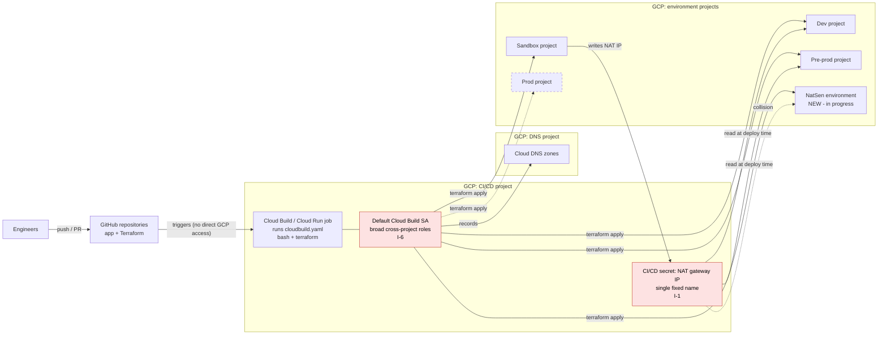
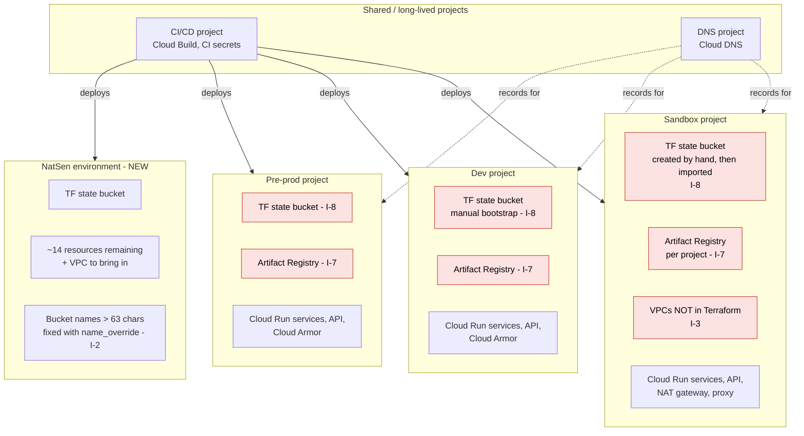
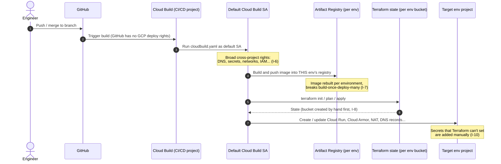
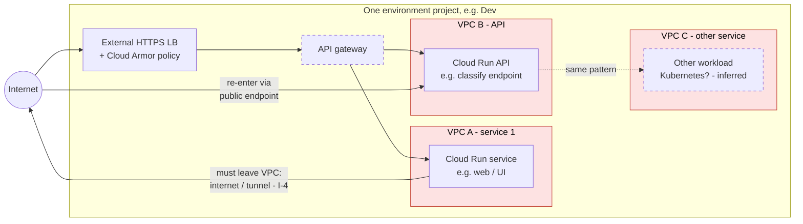
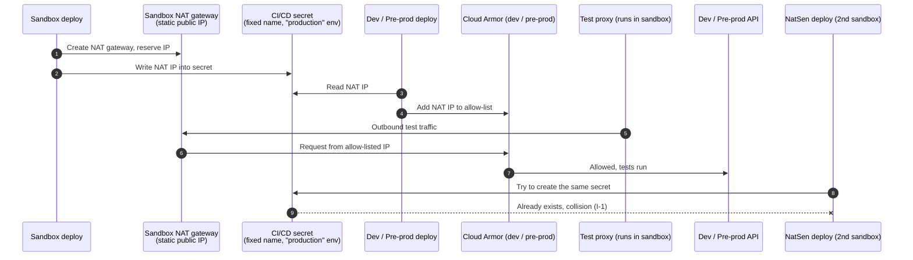
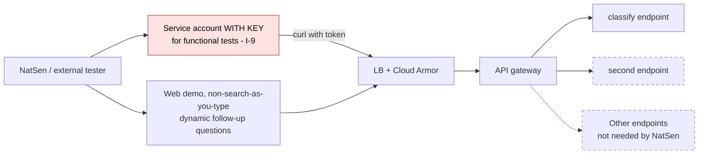
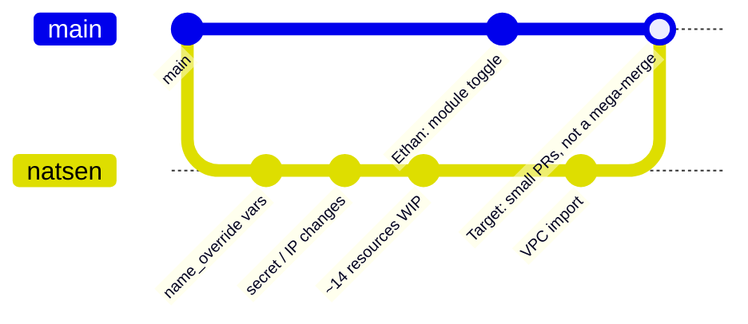

# Current Setup – Pipeline to Cloud Infrastructure (As Understood)

**Date:** 2026-10-22
**Source:** reconstructed from the tech meeting transcript (`tech-meeting.txt`) and the summary (`tech-meeting-summary.md`).
**Status:** DRAFT for review. Built from a conversation, not from the codebase or the GCP console, so parts are inferred.

> **How to read the diagrams**
> - Solid boxes = **stated** in the meeting.
> - Dashed boxes = **inferred** (sensible assumption, needs confirming).
> - Red boxes = **problem area** raised in the meeting.
> - `I-n` labels link to the issues register in section 8.

---

## 1. Big picture

**In words:** engineers push to GitHub. GitHub is not allowed to touch GCP directly, so it triggers Cloud Build (or a Cloud Run job) in a CI/CD project. That job runs Terraform and bash as the **default Cloud Build service account**, which has rights across every project. That account builds out each environment project, the DNS records, and so on.

---

## 2. GCP project layout and resource lifecycles

| Project | Holds | Lifecycle | Notes |
|---|---|---|---|
| CI/CD | Cloud Build, CI secrets | Long-lived | Described as "very specific" in scope, so not used as a general hub |
| DNS | Cloud DNS zones | Long-lived | Separate project just for DNS |
| Sandbox | App stack, NAT gateway, test proxy, VPCs | Env | VPCs exist outside Terraform |
| Dev | App stack, Cloud Armor | Env | Allow-lists the sandbox NAT IP |
| Pre-prod | App stack, Cloud Armor | Env | Allow-lists the sandbox NAT IP |
| Prod | App stack | Env | *Inferred* – "all of the real environments" mentioned |
| NatSen | New app stack for the external consumer | Env | Being built on a separate branch |

Each environment project owns its own **state bucket** and **Artifact Registry**. That's why there is a manual bootstrap step per project, and why images get rebuilt per environment.

---

## 3. Deployment pipeline (CI/CD flow)

**The security point raised:** the requirement is "no GitHub service account that can access environments." Today GitHub can't create resources itself, but it can ask Cloud Build to, and Cloud Build can do anything. The engineer's analogy was "sudo, get me a cup of coffee": the risk has been moved one level down, not removed (**I-6**).

---

## 4. Network design

**What was said:** each service (e.g. "staff" / Cloud Run / a separate API) has **its own VPC**. Services that need to talk to each other go **out via the internet or a tunnel and back in**, instead of talking privately on a shared VPC. Each service needs its own ingress openings, so the separation adds **more** exposed surface, not less (**I-4**).

---

## 5. Cross-environment test proxy and the NAT IP secret

This explains why a second sandbox-style environment (NatSen) breaks things.

**Why it matters:**
- The secret name is static, so **only one sandbox can exist** (**I-1**).
- Dev and pre-prod security depend on an IP allow-list fed from another environment's deploy. This couples the environments together and makes deployment **order-dependent** (sandbox must deploy first) (**I-5**).
- In the meeting, this proxy was described as "the stupid janky proxy thing".

---

## 6. External consumer access (NatSen) and functional testing

- NatSen will mainly use **about 2 endpoints** (e.g. *classify*). Getting a response back covers about 90% of what they need.
- The **web demo** they'll use is the dynamic question flow, not search-as-you-type. It can run hosted in sandbox or on localhost pointed at the sandbox API.
- Functional testing currently plans a **service account key** (**I-9**).

---

## 7. Source control and ways of working

- **Long-lived NatSen branch.** Max 1–2 weeks before divergence becomes painful (**I-11**).
- **Ethan's team is changing modules in parallel** (a new toggle), so a rebase is coming.
- **Few reviewers.** The existing team is busy with January testing and Kubernetes issues, so review capacity is the bottleneck. Rupert has been added as a reviewer.
- **Manual steps are undocumented.** There's no runbook for secrets and bootstrap, so environment rebuild/DR depends on people's memory (**I-10**).
- **Duplicated Terraform.** Copy-paste across modules (**I-12**).

---

## 8. Issues register

| ID | Area | Issue | Impact | Severity | Fix direction (raised or suggested) |
|---|---|---|---|---|---|
| I-1 | Pipeline / secrets | NAT IP stored in a **single fixed-name CI/CD secret** | Only one sandbox can exist; NatSen collides | High (blocking now) | Per-environment secret name via override variable, or read IP from Terraform remote state |
| I-2 | Terraform | Interpolated **bucket names exceed 63 chars** | New env fails to create buckets | Medium | `name_override` with old default – **done** |
| I-3 | Terraform | **Sandbox VPCs not in Terraform** | Drift, can't reproduce env, hidden changes | Medium | `terraform import` (use `import` blocks) |
| I-4 | Network | **One VPC per service**; inter-service traffic leaves the VPC | Larger attack surface, more ingress rules, latency, egress cost | Medium–High | Shared VPC with subnets and firewall segmentation, internal ingress – **deferred to January** |
| I-5 | Network / testing | Dev/pre-prod **Cloud Armor allow-lists sandbox NAT IP**, fed via a CI secret | Couples environments; deploy-order dependency; fragile proxy | Medium | Retire the proxy; authenticated test identity instead of IP allow-listing |
| I-6 | Security | **Default Cloud Build SA** with broad cross-project rights; GitHub can trigger it | One compromise = every environment; requirement met in letter, not intent | **High** | Now: dedicated least-privilege deployer SA per env. Later: GitHub OIDC (Workload Identity Federation) + impersonation chain |
| I-7 | Build / release | **Artifact Registry per project**; images rebuilt per env | Breaks build-once-deploy-many; what's tested ≠ what's deployed | Medium | Central registry, promote by digest – **deferred** |
| I-8 | Bootstrap | **State bucket made by hand**, then Terraform conflicts, then import | Slow, error-prone new environments | Medium | Management/seed project owns all state buckets – **deferred** |
| I-9 | Security / testing | **Service account key** planned for functional tests | Long-lived credential leak risk; may be blocked by org policy | Medium | Short-lived tokens via SA impersonation; if a key is needed, store it in Secret Manager and rotate it |
| I-10 | Operations | **Manual steps undocumented** (e.g. secrets) | Slow onboarding; no disaster-recovery runbook | Medium | Confluence checklist – **agreed action** |
| I-11 | Ways of working | **Long-lived divergent branch** + parallel module changes | Big risky merge; review overload | Medium | Small no-op PRs to `main`; Rupert reviews – **agreed** |
| I-12 | Code quality | **Duplicated Terraform** | Changes made in multiple places; inconsistency | Low–Medium | De-duplicate in small PRs |
| I-13 | Project layout | **Shared concerns split** across CI/CD + DNS + every env project | Fragmented ownership; mixed lifecycles | Low–Medium | Single management/hub project – **deferred** |

---

## 9. Does it make sense? Sanity check

**Yes. The engineer's critique hangs together.** The issues aren't independent; most trace back to two root causes:

1. **No central "foundation" layer.** State, registries, DNS and secrets are scattered per project. That produces I-7, I-8 and I-13, and it's why I-1 had no proper home.
2. **Security done by placement, not by identity.** Separate VPCs (I-4), IP allow-lists (I-5), and "GitHub can't deploy, Cloud Build can" (I-6) all try to get security from *where things sit* rather than *who is allowed to do what*. In each case it adds complexity without reducing the real risk.

The one place to be careful: separate VPCs **can** be a deliberate choice for isolation or compliance. Before arguing for consolidation, ask the original authors why they chose it. There may be a requirement nobody mentioned in the meeting.

---

## 10. Open questions to confirm with the engineers

1. Is the deploy runner **Cloud Build** or a **Cloud Run job**? (Both were mentioned.)
2. Is the "CI/CD secret" a **GitHub Environment secret** (named "production") or a **Secret Manager** secret in the CI/CD project?
3. Is there a separate **prod project**, and is it deployed by the same default SA?
4. Where does **Kubernetes** fit: GKE in each env, or only some workloads?
5. Is the **API gateway** GCP API Gateway, Apigee, or a custom service behind the load balancer?
6. Why were **separate VPCs per service** chosen – is there a written security or compliance requirement?
7. Exactly which **Cloud Build SA roles** are granted, and at what level (project / folder / org)?
8. Is service account key creation allowed by **org policy**?
9. Which **two endpoints** does NatSen need, and what auth do they expect?
10. Which resources other than VPCs exist **outside Terraform**?
