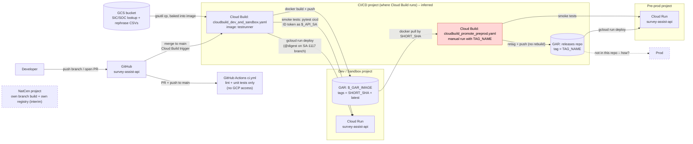
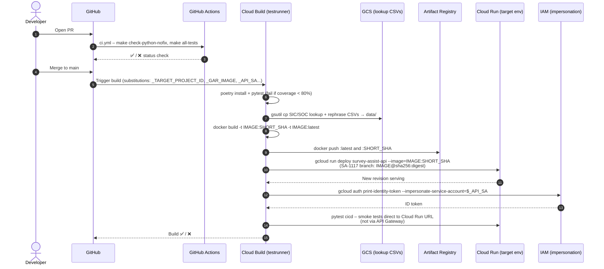
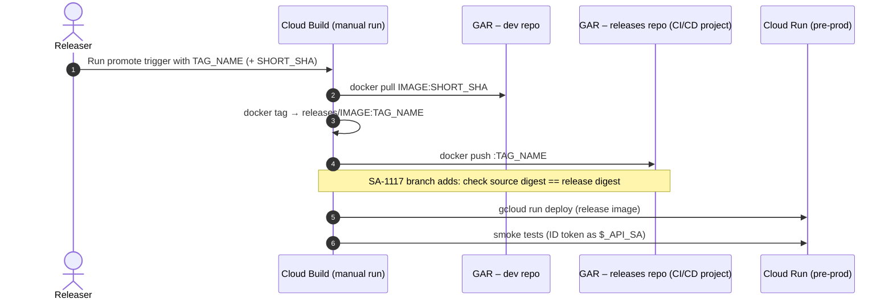
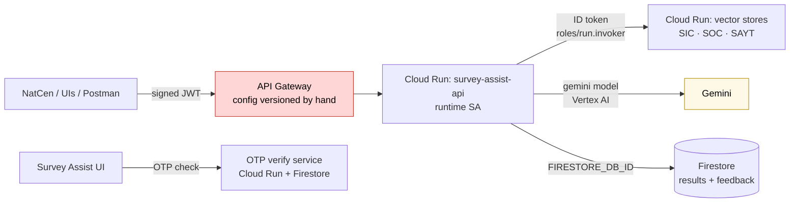

# Survey Assist API – Deployment Flow (Code to Cloud Run)

**Date:** 2026-10-29
**Status:** DRAFT. Built from the `survey-assist-api` repo (`main` + branch `sa-1117-build-promote-single-image`), not from the GCP console. Items marked *inferred* need confirming with Dan / Ethan.
**Sources:** `.github/workflows/ci.yml`, `cicd/cloudbuild_dev_and_sandbox.yaml`, `cicd/cloudbuild_promote_preprod.yaml`, `Dockerfile`, `docs/gcp_deployment.md`, plus meeting notes (`271026-infra-sync-summary.md`, `28-Oct26-DanCatchUp.md`).
**Related diagrams:** infra/Terraform pipeline → [current-setup.md §3](current-setup.md) · target build-once design → [J8 ticket §3](tickets/J8-build-once-promote-many.md) · runtime call flow → [app-demo-summary.md §5](app-demo-summary.md)

> **How to read the diagrams**
> - Solid = **seen in code/docs**. Dashed = **inferred**, confirm.
> - Two separate pipelines touch an environment: **app pipeline** (Cloud Build: build image, `gcloud run deploy`) and **infra pipeline** (Terraform: creates Cloud Run service, gateway, IAM…). This doc is mainly the app pipeline.
> - **GitHub Actions does not deploy.** It only lints and tests. Deployment is **Cloud Build**, triggered from GitHub.

---

## 1. Big picture

**In words:**
1. **Developer pushes** to GitHub. **GitHub Actions** runs lint + tests on the PR. It never touches GCP.
2. **Merge to `main`** fires a **Cloud Build trigger**. One build step (in the `testrunner` image) does everything: tests (80% coverage gate) → copy lookup CSVs from GCS → `docker build` → push to Artifact Registry → `gcloud run deploy` → smoke tests.
3. The same YAML serves **dev and sandbox** (the target comes from `$_TARGET_PROJECT_ID`), so **the image is built once per environment** today. That's the J8 / SA-1117 problem.
4. **Pre-prod** is a **manual** Cloud Build run with a `TAG_NAME`: it pulls the **dev** image by SHA, retags it, pushes to the **releases** repo, deploys to pre-prod and runs smoke tests. No rebuild.
5. **Prod** and **NatCen** paths aren't in this repo.

---

## 2. Dev / sandbox deploy, step by step

---

## 3. Pre-prod promotion, step by step

---

## 4. What the deployed API touches at runtime

Not created by the app pipeline. These come from **Terraform** or **manual steps**, but the deploy only works if they exist.

---

## 5. Services and identities touched

| Step | Service | Identity | Seen in |
|---|---|---|---|
| Lint/test on PR | GitHub Actions | GitHub runner (no GCP creds) | `ci.yml` |
| Trigger | Cloud Build trigger | – | Trigger defined in CI/CD repo (Terraform) – *inferred* |
| Build/test/deploy | Cloud Build, `gcr.io/$PROJECT_ID/testrunner` image | Cloud Build SA (default SA per infra notes) | both cloudbuild YAMLs |
| Lookup data | GCS (`$_SIC_LOOKUP_CSV` etc.) | Cloud Build SA | dev YAML |
| Image store | Artifact Registry (env repo; releases repo in build project) | Cloud Build SA | both YAMLs |
| Deploy | Cloud Run Admin API (`gcloud run deploy`) | Cloud Build SA (needs `run.developer` + `iam.serviceAccountUser` on runtime SA) | both YAMLs |
| Smoke test | IAM Credentials (ID token) → Cloud Run | Cloud Build SA impersonating `$_API_SA` | both YAMLs |
| Runtime | Vector stores, Vertex AI, Firestore | API runtime SA (`run.invoker` on vector stores, `iam.serviceAccountTokenCreator`) | `docs/gcp_deployment.md` |
| Public entry | API Gateway (JWT, `x-google-issuer` = API access SA) | Client signs JWT as API access SA | `docs/gcp_deployment.md` |

## 6. Manual steps / gaps (known so far)

- **Pre-prod promotion** is a manual Cloud Build run.
- **API Gateway config** is versioned by hand (`gcloud api-gateway api-configs create` + `gateways update`).
- **NatCen** builds from its own branch into its own registry (interim, Gemini model change).
- **Prod** deploy path not in this repo. *Confirm.*
- **Image built per environment** (dev and sandbox each run the full YAML), being fixed by J8 / SA-1117.
- **Smoke tests bypass the API Gateway** (direct Cloud Run URL), so gateway config/JWT issues aren't caught by the pipeline (Postman collection covers this).

## 7. Questions to confirm

1. Which project does Cloud Build run in for each trigger, and where does `_GAR_IMAGE` point for dev vs sandbox?
2. How does prod get deployed?
3. Is the Cloud Build SA still the default SA, or a dedicated deployer SA?
4. Does Terraform also set the Cloud Run image (risk of rolling back a deploy), or does it `ignore_changes = [image]`?
