# Proposed Setup – Pipeline to Cloud Infrastructure

**Date:** 2026-10-22
**Companion to:** `current-setup.md` (issue IDs `I-1`…`I-13` refer to that file's issues register) and `tech-meeting-summary.md`.
**Status:** DRAFT for review. This combines **what was proposed in the meeting** with **additional recommendations** (gaps not discussed). Each item is labelled so you can tell which is which.

> **How to read the diagrams**
> - Green boxes = **new or changed** compared with the current setup.
> - Blue boxes = **additional recommendation** (not discussed in the meeting).
> - Plain boxes = **unchanged**.
> - Dashed boxes = **optional / later phase**.
> - `I-n` = the current-setup issue this change resolves. `G-n` = a gap not discussed (section 10).

---

## 1. What changes at a glance

| Area | Current | Proposed | Source | Fixes |
|---|---|---|---|---|
| Shared services | Split across CI/CD project, DNS project, and every env project | **One management (hub) project**: state, Artifact Registry, DNS parent zone, CI identity, static secrets, test runner | Meeting | I-7, I-8, I-13 |
| CI/CD runner | GitHub triggers Cloud Build running as **default SA** | **GitHub Actions + Workload Identity Federation (keyless)**, impersonating **per-env deployer SAs** | Meeting | I-6 |
| Deploy permissions | One broad cross-project SA | **One least-privilege deployer SA per environment** + read-only planner SA | Meeting + extended | I-6 |
| Images | Rebuilt per env, per-project registry | **Build once**, central registry, **promote by digest** | Meeting | I-7 |
| State | Hand-made bucket per project, then imported | **Bootstrap stack** creates versioned state buckets in management project | Meeting | I-8 |
| Network | One VPC per service, traffic via internet | **One VPC per environment**, subnets per tier, private service-to-service traffic | Meeting | I-4 |
| Env isolation | Envs coupled via shared NAT IP secret | **Envs fully independent**; no cross-env allow-lists | Extended | I-1, I-5 |
| Test access | Sandbox proxy + NAT IP allow-listed in Cloud Armor | **Identity-based** test access (short-lived tokens) from the management project | Extended | I-5, I-9 |
| Secrets | Ad-hoc, manual, undocumented | **Secret Manager** in the right project, referenced as data sources, documented | Meeting + extended | I-1, I-10 |
| Unmanaged resources | VPCs outside Terraform | Imported via `import` blocks; drift detection | Meeting + extended | I-3 |
| Ways of working | Long-lived branch | Small no-op PRs to `main`, plan-on-PR, CODEOWNERS | Meeting + extended | I-11, I-12 |
| Guardrails | None mentioned | **Org policies, policy-as-code, audit logs, VPC-SC**, scanning | **Extended** | G-1…G-14 |

---

## 2. Proposed big picture

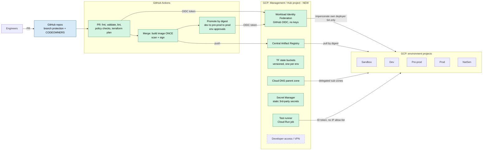

**What's different from the current setup**
- **No Cloud Build default SA.** GitHub Actions authenticates keylessly through WIF and can only **impersonate** the deployer SA for the environment it targets (I-6).
- **Everything shared lives in one place** (management project), so new environments don't need a manual bootstrap (I-8, I-13).
- **Images are built once** and the same digest moves through environments (I-7).
- **No cross-environment NAT IP secret.** Tests authenticate by identity, not by source IP (I-1, I-5).

---

## 3. Resource hierarchy, projects and lifecycles

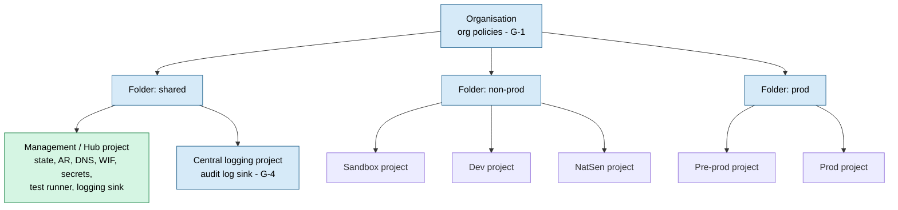

| Layer | Lifecycle | Managed by | Changes |
|---|---|---|---|
| Org / folders / org policies | Very long | Bootstrap stack (admins only) | **New.** Guardrails applied once, inherited by every project |
| Management project | Long | Bootstrap stack | **New.** Replaces the separate CI/CD + DNS projects and the per-env registries and state buckets |
| Environment projects | Env lifetime | Per-env stack via deployer SA | **Changed.** Only hold workload resources; no registry, no state bucket |
| Application releases | Short | App pipeline | **Changed.** Deploy a digest; no rebuild |

Separating these three Terraform layers (**bootstrap**, **platform/env**, **app**) matches the lifecycle point raised in the meeting: DNS and state shouldn't share a lifecycle with app resources.

> **Pre-prod placement:** shown under the *prod* folder so it gets prod-grade guardrails and is a true rehearsal for prod. Move it if that's too strict.

---

## 4. Identity and CI/CD security chain

### 4.1 Current vs proposed

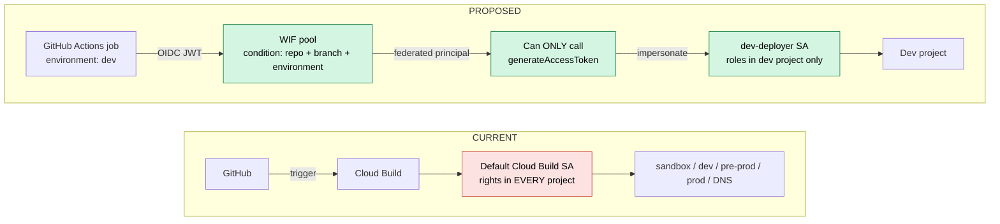

### 4.2 Deployment flow

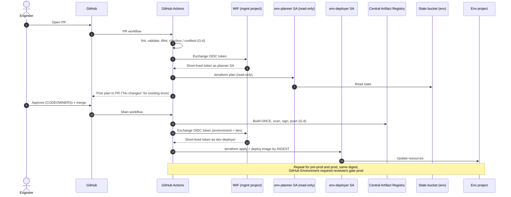

**Improvements**
- **No long-lived credentials anywhere** in the pipeline. WIF tokens last about an hour.
- **Blast radius is one environment.** A compromised dev workflow can't touch prod.
- **Separate planner (read-only) and deployer SAs.** PRs from branches can only *plan*, not *apply*.
- **Attribute conditions** stop forks and other repos from minting tokens.
- **Every impersonation is in Cloud Audit Logs**, so we can see who deployed what and when.

> **Security requirement check:** the requirement says "no GitHub service account with environment access". With WIF there is **no GitHub-held key and no SA in GitHub**. GitHub gets a federated identity that can only impersonate. **Get written sign-off from the requirement owner before January.**

---

## 5. Network design

### 5.1 Proposed per-environment network

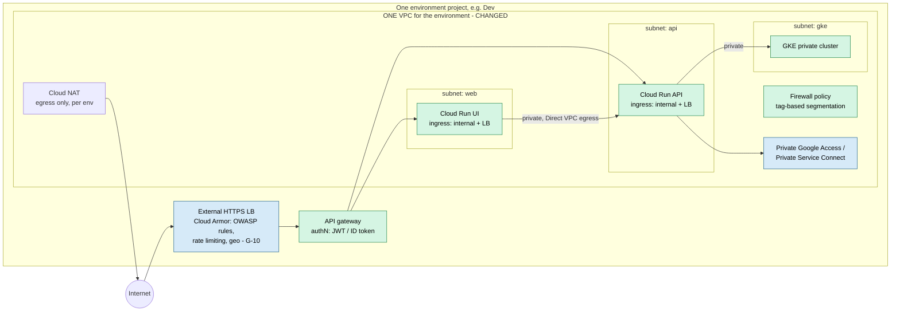

### 5.2 What changes and why

| Topic | Current | Proposed |
|---|---|---|
| VPCs | One per service | **One per environment**, subnets per tier |
| Service-to-service | Out via internet / tunnel | **Private** via Direct VPC egress + internal ingress |
| Segmentation | VPC boundaries | **Firewall policies with secure tags / service accounts**. Keeps segmentation, removes public hops |
| Cloud Run ingress | Likely `all` | `internal-and-cloud-load-balancing`, so services can't be called directly from the internet |
| Google APIs | Probably via internet / NAT | **Private Google Access / PSC** |
| Cross-env | Linked by NAT IP allow-list | **No connectivity between environments** (no peering) |

> **Important nuance:** "consolidate VPCs" means **within** an environment, **not across** environments. Dev, pre-prod and prod keep separate networks. Optionally host them as **Shared VPC host projects** per environment if multiple service projects per env appear later.

---

## 6. Test access – replacing the proxy and NAT IP allow-list

### 6.1 Interim fix (now, no-op for existing envs)

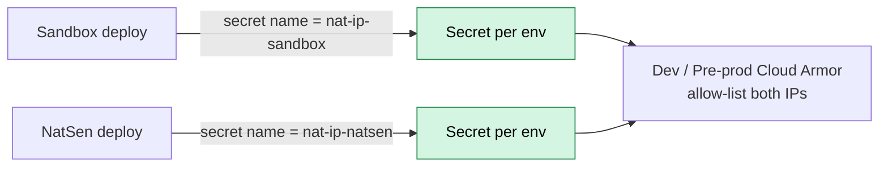

Use an override variable for the secret name, with the default kept as today's name, so existing envs show no changes. **Unblocks I-1 immediately.**

### 6.2 Target (January+)

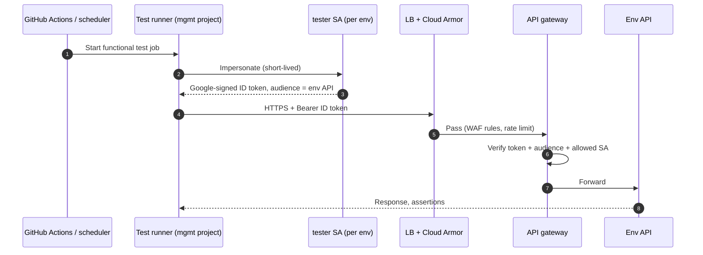

**What changes**
- The **sandbox proxy is retired**. There's no reason for one environment to test another.
- **Cloud Armor goes back to its proper job** (WAF and rate limiting) instead of being the authentication mechanism.
- **No SA keys** for testing (I-9). Tokens are short-lived, scoped to one API audience, and auditable.

---

## 7. External consumer access (NatSen)

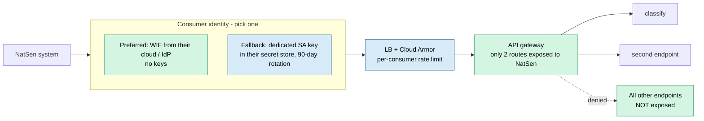

**What changes:** least-privilege exposure (only the ~2 endpoints NatSen needs), a per-consumer identity and rate limit, and keyless authentication where their platform supports it. Also agree an **API contract and SLA** with them (G-12).

---

## 8. Terraform and repository structure

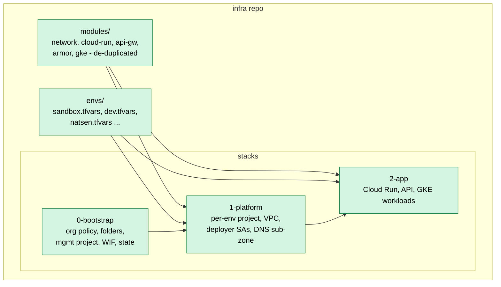

- **Bootstrap** is run rarely, by admins, and creates what everything else depends on, which removes the manual state bucket step (I-8).
- **A new environment = a new `.tfvars` file** plus one PR, with no hand-made resources. NatSen becomes the template.
- **Override variables with backward-compatible defaults** remain the rule for every change (I-2, I-11).
- **Existing resources** are brought in with `import` blocks and checked for a clean plan (I-3).
- Add **scheduled drift detection** (nightly `terraform plan` with the result posted to a channel) (G-7).

---

## 9. Ways of working

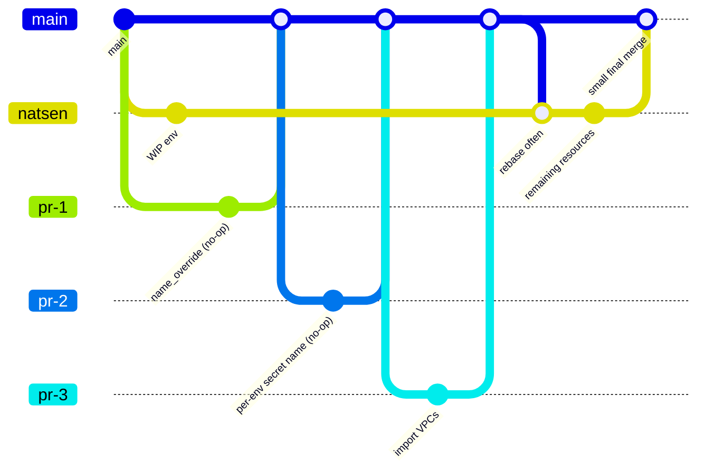

- **Small PRs, each with a plan attached** showing "No changes" for existing envs. Rupert reviews.
- **CODEOWNERS** for `0-bootstrap` and prod tfvars (G-13).
- **Confluence runbook:** manual steps, rebuild-an-env checklist, break-glass procedure (I-10, G-11).
- **ADR** for each January decision (management project, WIF, network) so the reasoning is recorded.

---

## 10. Gaps not discussed in the meeting

These weren't raised but would materially improve **security** or **architecture**. Ordered by value for effort.

| ID | Gap | Why it matters | Effort | When |
|---|---|---|---|---|
| G-1 | **Org policies**: disable SA key creation, restrict resource locations (UK/EU), disable default SA grants, require OS Login, restrict public IPs, uniform bucket access | Guardrails that stop mistakes in every project automatically | Low | Now (non-prod first) |
| G-2 | **Remove default SA usage** in Cloud Run / GKE; give each workload its own SA | Default compute SA often has Editor, a big lateral-movement risk | Low | Now |
| G-3 | **Dedicated deployer SA in Cloud Build** (bridge until GitHub Actions) | Closes most of I-6 before January without changing tools | Low | **Now – recommended quick win** |
| G-4 | **Central audit logging**: Admin + Data Access logs to a locked log bucket in a logging project | Forensics, compliance, "who changed what" | Low | Before January |
| G-5 | **State bucket hardening**: versioning, retention lock, uniform access, per-env IAM, optionally CMEK | State contains secrets and is the keys to the kingdom | Low | With the management project |
| G-6 | **Policy-as-code in PRs**: `tflint`, `checkov`/`tfsec`, `conftest`/OPA | Catches public buckets, open firewalls, wide IAM before merge | Low–Med | Before January |
| G-7 | **Drift detection** (scheduled plan) | Finds manual console changes, which already happened with the VPCs | Low | Before January |
| G-8 | **Supply chain**: Artifact Analysis vulnerability scanning, SBOM, image signing + Binary Authorization on GKE / Cloud Run | Guarantees only built-and-scanned images run | Med | January+ |
| G-9 | **VPC Service Controls** perimeter around data services (Storage, BigQuery, Secret Manager) | Stops data exfiltration even with stolen credentials | Med–High | Later |
| G-10 | **Cloud Armor as a real WAF**: OWASP preconfigured rules, rate limiting, bot / geo rules, Adaptive Protection | Today it's used as an IP gate; it should protect the API | Low–Med | Before NatSen go-live |
| G-11 | **Break-glass access** + **JIT / PAM** for humans; no standing Owner/Editor | Humans are the other path into prod. JIT is already used for laptops | Med | January+ |
| G-12 | **Observability and SLOs**: uptime checks, error-rate / latency alerts, dashboards, on-call route for NatSen endpoints | No mention of monitoring for an external consumer | Med | Before NatSen go-live |
| G-13 | **Repo hardening**: branch protection, required reviews, signed commits, CODEOWNERS, Dependabot, secret scanning, pinned Action SHAs | The pipeline is only as safe as the repo | Low | Now |
| G-14 | **Backup / DR**: tested env rebuild from code, data backups (Cloud SQL / GCS / Firestore if used), defined RPO/RTO | Runbook was discussed; testing it wasn't | Med | January+ |
| G-15 | **Cost guardrails**: budgets + alerts per project, labels on all resources, auto-teardown for sandbox-type envs | More environments means more spend; NatSen adds another | Low | Now |
| G-16 | **Secrets lifecycle**: Secret Manager rotation, no secrets in tfvars or state where avoidable, ephemeral resources | Manual secrets were mentioned with no rotation story | Med | January+ |
| G-17 | **Data classification and residency**: what data hits *classify*, PII handling, region lock | External consumer + possibly personal data means a DPIA may be required | Med | Before NatSen go-live |
| G-18 | **GKE hardening** (since Kubernetes is in use): private cluster, Workload Identity, Autopilot or Shielded Nodes, network policies | Recent Kubernetes trouble suggests it's worth a review | Med | January+ |

---

## 11. Phased roadmap

```mermaid
flowchart LR
    classDef now fill:#d5f5e3,stroke:#1e8449,color:#000
    classDef jan fill:#fef9e7,stroke:#b7950b,color:#000
    classDef later fill:#d6eaf8,stroke:#1f618d,color:#000

    subgraph P0["Phase 0 - NOW to Dec<br/>no-op, low risk"]
        A1["Per-env secret name - I-1"]:::now
        A2["name_override - I-2 done"]:::now
        A3["Import VPCs - I-3"]:::now
        A4["Dedicated Cloud Build deployer SA - G-3"]:::now
        A5["Confluence runbook - I-10"]:::now
        A6["Repo hardening, budgets - G-13, G-15"]:::now
        A7["Cloud Armor WAF + monitoring<br/>for NatSen - G-10, G-12"]:::now
    end

    subgraph P1["Phase 1 - January<br/>foundation"]
        B1["ADRs + security sign-off"]:::jan
        B2["Management project<br/>bootstrap stack"]:::jan
        B3["Migrate state to central buckets"]:::jan
        B4["Central Artifact Registry,<br/>promote by digest"]:::jan
        B5["GitHub Actions + WIF<br/>per-env deployer SAs"]:::jan
        B6["Retire proxy, identity-based tests"]:::jan
    end

    subgraph P2["Phase 2 - Q1<br/>network + hardening"]
        C1["One VPC per env,<br/>private service traffic"]:::later
        C2["Org policies to prod folder"]:::later
        C3["Binary Authorization, scanning"]:::later
        C4["Audit log sink, drift detection"]:::later
    end

    subgraph P3["Phase 3 - later"]
        D1["VPC Service Controls"]:::later
        D2["PAM / break-glass"]:::later
        D3["DR test"]:::later
    end

    P0 --> P1 --> P2 --> P3
```

**Why this order**
- **Phase 0** is all **no-op or additive** for existing envs, so it fits the "don't burden reviewers before January" decision.
- **Phase 1** comes before Phase 2 because the network migration is the riskiest change and needs the safer pipeline and central state in place first.
- **Retiring the proxy** (Phase 1) has to happen **before** the network change, because the network change would break the NAT IP allow-list flow anyway.

---

## 12. Risks of the proposed setup

| Risk | Mitigation |
|---|---|
| Management project becomes a **single high-value target** | Separate admin group, no human standing access (PAM), org policies, audit sink, VPC-SC later |
| **State migration** goes wrong | `terraform init -migrate-state` per env, bucket versioning, back up state first, do non-prod first |
| **Network migration** causes downtime | Build the new VPC alongside the old, move services one at a time, validate in sandbox/NatSen first |
| WIF **misconfigured** (no attribute condition) lets any GitHub repo mint tokens | Always set `attribute_condition` on repo owner + repo + ref / environment; test with a forked repo |
| **Review overload** again in January | Phase plan, ADRs agreed up front, small PRs |
| Separate VPCs were a **hidden compliance requirement** | Ask the original authors before Phase 2 (open question carried over from current-setup.md) |

---

## 13. Decisions needed

1. Security owner sign-off: does **WIF + impersonation** satisfy the "no GitHub SA" requirement?
2. Approve **G-3 (dedicated Cloud Build deployer SA)** as a pre-January quick win?
3. Should **pre-prod** sit in the prod folder (prod-grade guardrails)?
4. **Per-env VPC** in the env project, or **Shared VPC host** per env?
5. What auth method does **NatSen** use: WIF from their side, or a managed key?
6. Is a **DPIA / data classification** needed for the classify endpoint (G-17)?
7. Who **owns** the management project and bootstrap stack?
