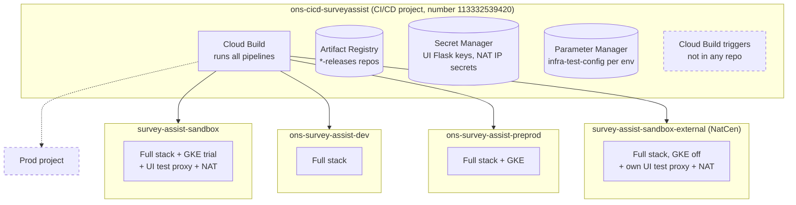
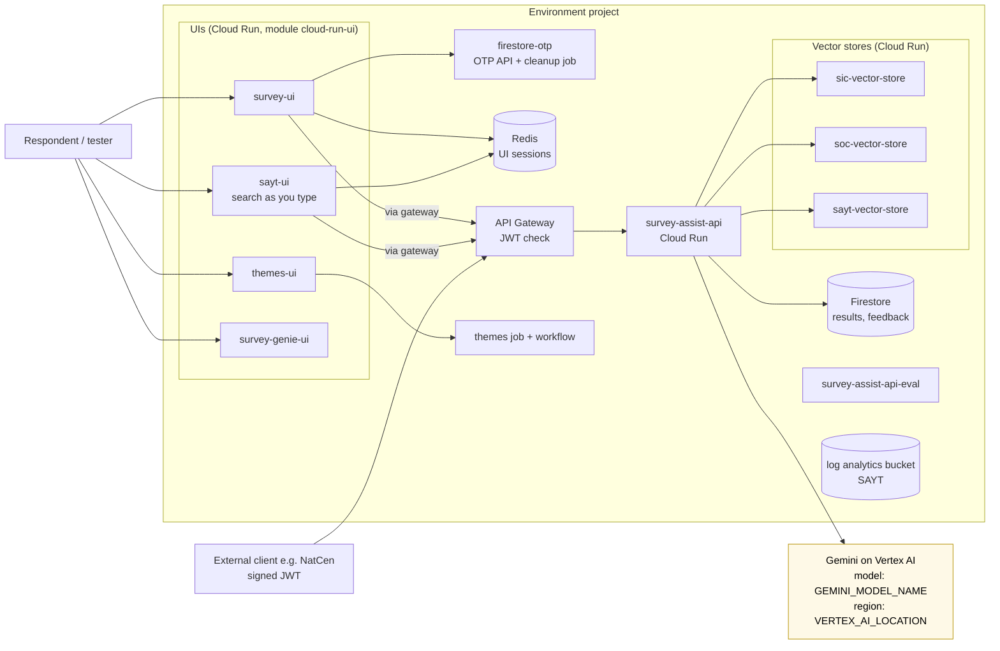
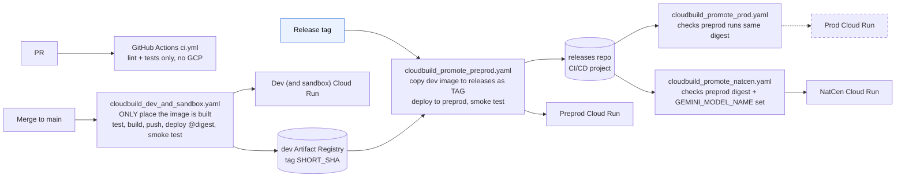
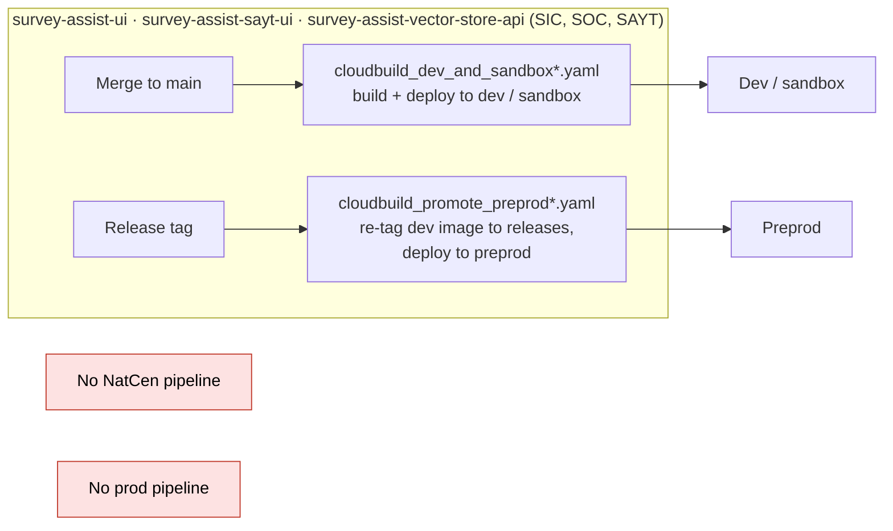
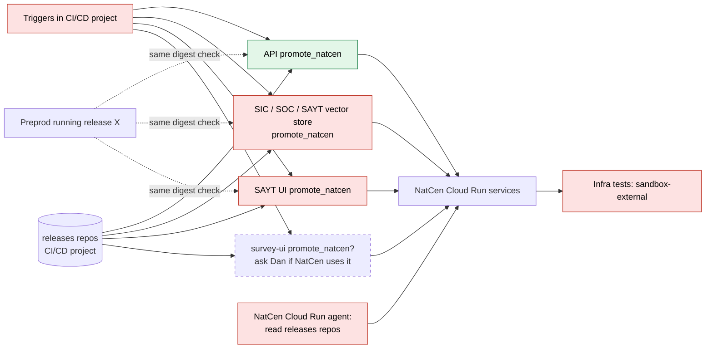
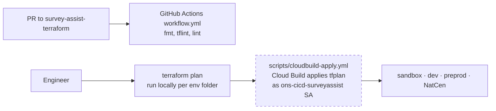
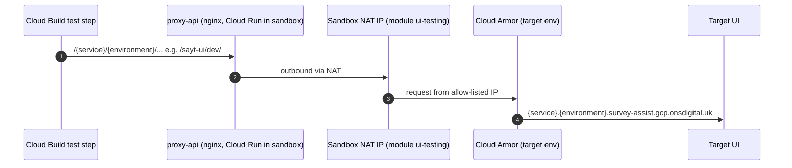

# Survey Assist – Architecture and Pipelines (single reference)

**Last checked:** 16 Nov 2026, against `main` in `survey-assist-api`, `survey-assist-terraform`, `survey-assist-ui`, `survey-assist-sayt-ui` and `survey-assist-vector-store-api`.
**Replaces** the diagrams in `current-setup.md`, `deployment-flow.md`, `proposed-setup.md` and `app-demo-summary.md` (Oct 2026). Those are kept for history but are out of date.

> **Key**
> - Solid line or box = seen in code.
> - Dashed = not in any repo or not confirmed (ask Dan / Ethan).
> - Red = gap or work still to do.

---

## 1. GCP projects

| Project | Terraform folder | Notes |
|---|---|---|
| `ons-cicd-surveyassist` | none (not in this repo) | Cloud Build, release images, shared secrets, test config |
| `survey-assist-sandbox` | `survey-assist-sandbox/` | Where new infra is tried first |
| `ons-survey-assist-dev` | `ons-survey-assist-dev/` | Gets every merge to main (app pipelines) |
| `ons-survey-assist-preprod` | `ons-survey-assist-preprod/` | Gets tagged releases |
| `survey-assist-sandbox-external` | `survey-assist-sandbox-external/` | NatCen. On main since 11 Nov |

---

## 2. Runtime architecture (one environment)

What runs inside each environment project and who calls what.

- The API reads `GEMINI_MODEL_NAME` (NatCen: `gemini-3.5-flash`, others: app default) and, once PR 82 merges, `VERTEX_AI_LOCATION` (default `europe-west2`).
- GKE (`vector-store-gke`) exists in sandbox and preprod as a trial. It's commented out in NatCen and not used in dev.
- UI Flask secret keys live in the **CI/CD project** and are shared across all environments (SA-1127).

---

## 3. App pipeline – Survey Assist API (build once, promote by digest)

This is the model the other apps should follow. Done in SA-1117.

- One image, built once on merge. Preprod, prod and NatCen all get **the same digest**, never a rebuild.
- Prod and NatCen promotes refuse to deploy unless preprod is running that exact release.
- Whether the prod and NatCen **triggers** exist is not visible in code (dashed).

---

## 4. App pipelines – other repos (today)

- Vector store and SAYT UI pipelines take `$_ENV_NAME` and read settings from Parameter Manager `infra-test-config`. NatCen's Terraform already creates its settings.
- These still re-tag on promote, rather than the API's digest checks.

---

## 5. NatCen CI/CD – target (what we're building)

Still to decide with Dan: promote from preprod (proposed) or deploy on merge, survey-ui in or out, proxy in the pipeline or not, where triggers are managed.

---

## 6. Infra pipeline – Terraform

- Each environment folder has its own state. Cloud Run images are ignored by Terraform (`ignore_changes`), so the app pipelines own what's deployed.
- Drift appears when someone applies from a feature branch or changes things by hand (for example `AUTH_METHOD`, `GEMINI_MODEL_NAME`).
- How plans reach the apply step is not clear from the repo (dashed).

---

## 7. UI test proxy and NAT IP

How tests reach dev, preprod and NatCen UIs through Cloud Armor.

- Each sandbox-style project (sandbox, NatCen) has its own NAT IP and its own secret name (SA-1122, merged).
- NatCen's Cloud Armor only allows **NatCen's own** NAT IP. Use the NatCen proxy to test NatCen (SA-1156).
- `proxy-api/cloudbuild.yaml` only deploys to sandbox. SA-1123 plans to move the proxy into the CI/CD project.

---

## 8. What changed since the October docs

| Then (Oct docs) | Now |
|---|---|
| NatCen on its own branch | On main, folder `survey-assist-sandbox-external` |
| One fixed NAT IP secret, NatCen clashes | Per-environment secret names |
| API image rebuilt per environment | Built once, promoted by digest to preprod, prod and NatCen |
| No prod or NatCen pipeline | API has both. Other apps don't yet |
| Gemini model set by hand on Cloud Run | Terraform input in review (189), NatCen value in draft (192) |
| Gemini region fixed | Configurable, in review (82, 190) |
