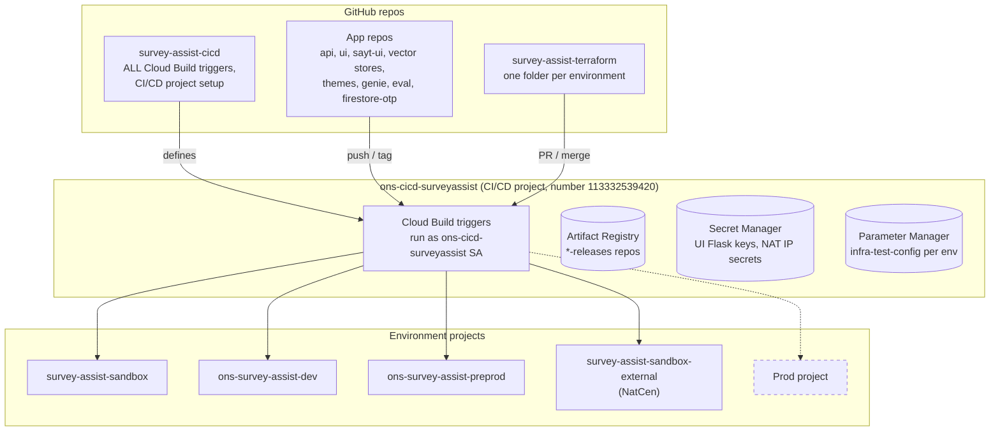
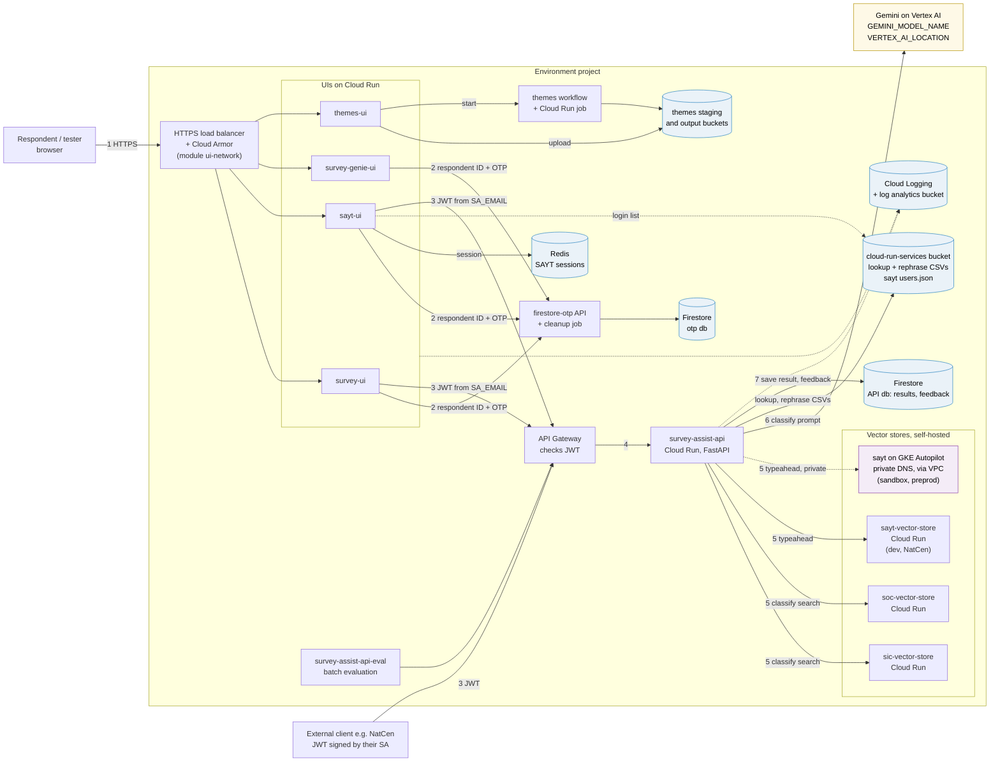
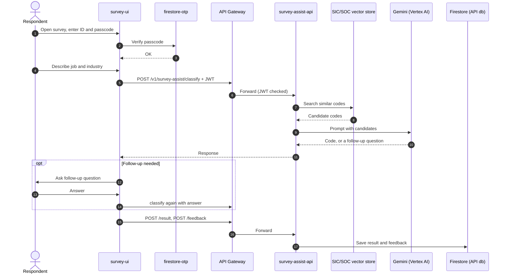
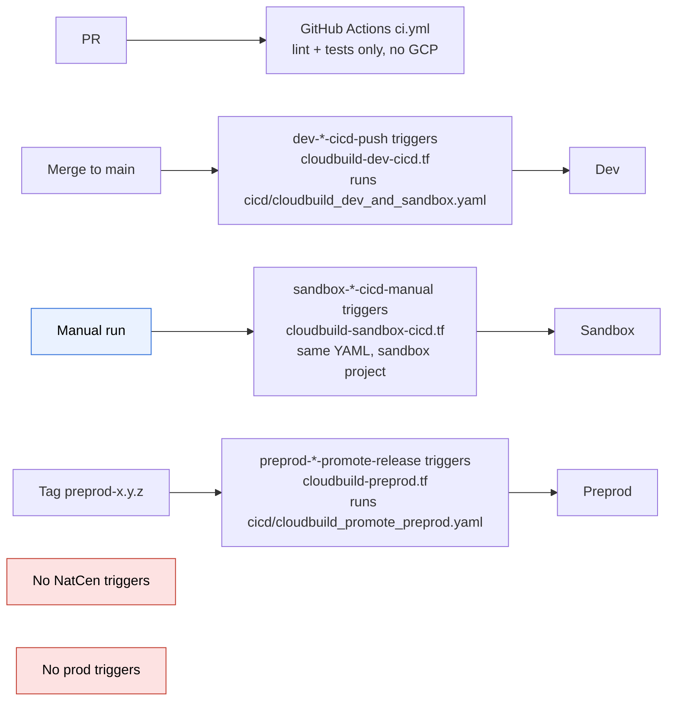
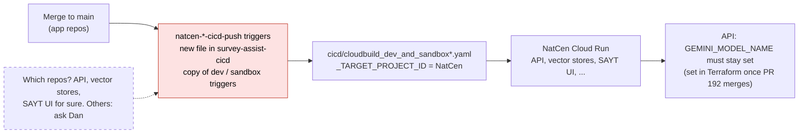
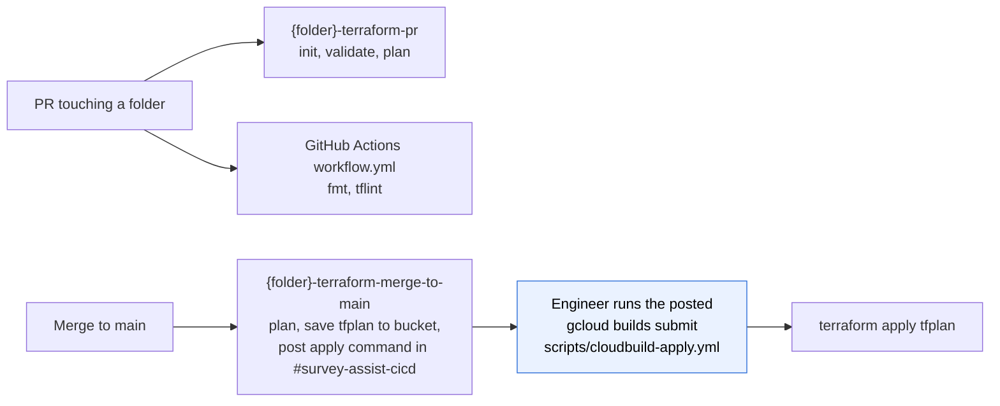
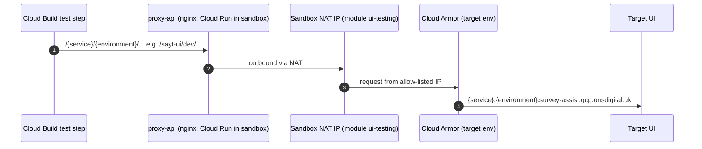

# Survey Assist – Architecture and Pipelines (single reference)

**Last checked:** 16 Nov 2026 (section 2 on 18 Nov), against `main` in `survey-assist-api`, `survey-assist-terraform`, `survey-assist-cicd`, `survey-assist-ui`, `survey-assist-sayt-ui` and `survey-assist-vector-store-api`, plus the Dan catch-up on 16 Nov.
**Replaces** the diagrams in `current-setup.md`, `deployment-flow.md`, `proposed-setup.md` and `app-demo-summary.md` (Oct 2026). Those are kept for history but are out of date.

> **Key**
> - Solid line or box = seen in code.
> - Dashed = not in any repo or not confirmed.
> - Red = gap or work still to do. Green = done.

---

## 1. GCP projects and repos

| Project | Terraform folder | Notes |
|---|---|---|
| `ons-cicd-surveyassist` | `survey-assist-cicd` repo | Cloud Build, release images, shared secrets, test config |
| `survey-assist-sandbox` | `survey-assist-sandbox/` | Where new infra is tried first. Not in the Terraform pipeline |
| `ons-survey-assist-dev` | `ons-survey-assist-dev/` | Gets every merge to main |
| `ons-survey-assist-preprod` | `ons-survey-assist-preprod/` | Gets `preprod-x.y.z` tags |
| `survey-assist-sandbox-external` | `survey-assist-sandbox-external/` | NatCen. On main since 11 Nov |

The CI/CD service account is Owner on dev, preprod and prod (granted in Platform Engineering's `gcp-terraform` repo). Dan confirmed on 16 Nov that it has the same level on NatCen.

---

## 2. Runtime architecture, end to end (one environment)

How a request travels from a user to the data and back. Every arrow is taken from the Terraform env vars and the API and UI code on `main` (checked 18 Nov).

**The journey, step by step**

1. The user opens a UI through the HTTPS load balancer, which has Cloud Armor in front of it.
2. The survey, SAYT and Genie UIs check the respondent's ID and one-time passcode against the firestore-otp API, which stores them in its own Firestore database.
3. The survey and SAYT UIs mint a JWT as the API Gateway service account (`SA_EMAIL`) and call the gateway. NatCen does the same with their own service account.
4. The gateway checks the JWT and forwards the request to the API.
5. For classify, the API searches the SIC or SOC vector store. For search-as-you-type it calls the SAYT vector store: Cloud Run in dev and NatCen, GKE over the VPC in sandbox and preprod.
6. The API sends the candidates to Gemini on Vertex AI to pick the code or ask a follow-up question.
7. The UI posts the result and any feedback back through the gateway, and the API saves them in Firestore.

The Themes UI is separate. It uploads files to a bucket and starts a workflow that runs a Cloud Run job.

### Classify journey (survey-ui)

**Notes**

- Vector stores are self-hosted, not a managed service. The vector data is copied into each image at build time from the environment's bucket.
- The API reaches the vector stores with Google ID tokens (authenticated Cloud Run). The GKE SAYT store is reached over the VPC (`vpc_access_enabled = true` in sandbox and preprod).
- Only the SAYT UI uses Redis for sessions. The other UIs use Flask cookie sessions.
- GKE is defined in sandbox, NatCen and preprod, but NatCen's API still calls the Cloud Run SAYT store. Dev has no GKE.
- UI Flask keys are a shared secret in the CI/CD project today. SA-1127 (PR 197) moves Themes to its own per-environment key.
- The API reads `GEMINI_MODEL_NAME` (NatCen: `gemini-3.5-flash`, others: the app default) and `VERTEX_AI_LOCATION` (default `europe-west2`).

---

## 3. App pipelines – triggers today

All defined in `survey-assist-cicd/ons-cicd-surveyassist/`.

| Trigger set | When | Repos covered |
|---|---|---|
| `dev-*-cicd-push` | Push to main | api, ui, sayt-ui, vector stores (generic, SIC, SOC, SAYT), themes, themes-ui, genie, eval, firestore-otp |
| `sandbox-*-cicd-manual` | Run by hand | Same set |
| `preprod-*-promote-release` | Tag `preprod-x.y.z` (SAYT store: `preprod-sayt-x.y.z`) | Same set |
| NatCen | None | – |
| Prod | None | – |

- The API repo has `cloudbuild_promote_natcen.yaml` and `cloudbuild_promote_prod.yaml` (SA-1117), but **no triggers use them yet**.
- The API's dev pipeline is the only place its image is built. Preprod promotes that image by digest. Other repos still re-tag on promote.

---

## 4. NatCen app deploys – target

**Decision (Dan, 16 Nov):** NatCen deploys **on merge to main**, for now. Not promote-from-preprod.

So the simplest route is NatCen triggers that copy the dev or sandbox ones, pointed at the NatCen project.

- Most of the work is in **survey-assist-cicd**, not the app repos, because the existing YAMLs already take the target project as a setting.
- Not part of SA-1119. Needs its own ticket or subtask.

---

## 5. Terraform pipeline (SA-1119)

Defined in `survey-assist-cicd/ons-cicd-surveyassist/cloudbuild-terraform-surveyassist-projects.tf`. One pair of triggers per folder in `terraform_folders`.

| Folder | In pipeline? |
|---|---|
| `ons-survey-assist-dev` | Yes |
| `ons-survey-assist-preprod` | Yes |
| `survey-assist-sandbox-external` (NatCen) | **PR open** (survey-assist-cicd 127) |
| `survey-assist-sandbox` | No, applied by hand |

SA-1119 steps:
1. Pin NatCen to `~>1.11.0` (terraform PR 194). The trigger downloads `terraform-<version>`, and every working folder pins three parts.
2. Add NatCen to `terraform_folders` (survey-assist-cicd PR 127).
3. CI/CD service account access to NatCen and its state bucket. Dan says it's already in place, to confirm on the first run.
4. Test with a no-op NatCen PR.

Apply isn't fully automatic for any environment. Merging posts a command in Slack and a person runs it.

---

## 6. UI test proxy and NAT IP

How tests reach dev, preprod and NatCen UIs through Cloud Armor.

- Each sandbox-style project (sandbox, NatCen) has its own NAT IP and its own secret name (SA-1122, merged).
- NatCen's Cloud Armor only allows **NatCen's own** NAT IP. Use the NatCen proxy to test NatCen (SA-1156).
- `proxy-api/cloudbuild.yaml` only deploys to sandbox. SA-1123 plans to move the proxy into the CI/CD project.

---

## 7. Open PRs (16 Nov)

| PR | What | Status |
|---|---|---|
| survey-assist-api 82 | Configurable Vertex AI region | Review comments answered, waiting approval |
| terraform 189 | Gemini model input | Dan planning on dev, then approving |
| terraform 190 | Vertex AI region input | After 189, then switch base to main |
| terraform 192 | NatCen Gemini model value | Draft until 189 merges |
| terraform 194 | NatCen Terraform version pin | Waiting review (SA-1119) |
| survey-assist-cicd 127 | NatCen in Terraform pipeline | Waiting review (SA-1119) |

---

## 8. What changed since the October docs

| Then (Oct docs) | Now |
|---|---|
| NatCen on its own branch | On main, folder `survey-assist-sandbox-external` |
| One fixed NAT IP secret, NatCen clashes | Per-environment secret names |
| API image rebuilt per environment | Built once in dev, promoted by digest to preprod |
| Triggers "not in any repo" | All in `survey-assist-cicd` |
| No NatCen pipeline at all | Terraform pipeline PR open. App triggers still to do, on merge to main |
| Gemini model set by hand on Cloud Run | Terraform input in review (189), NatCen value in draft (192) |
| Gemini region fixed | Configurable, in review (82, 190) |
