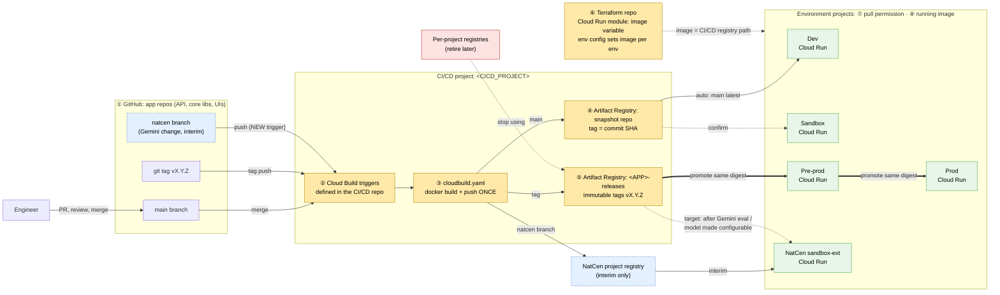
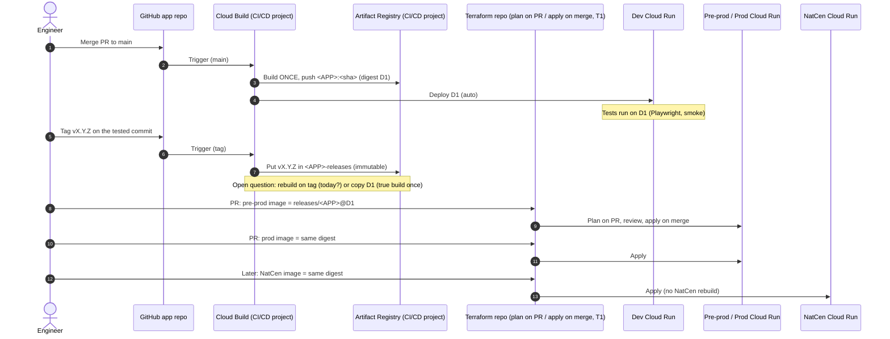
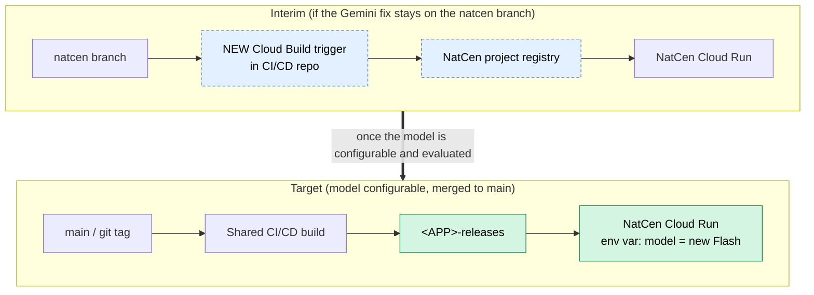

# J8: Build Once, Deploy Many (T3)

| Field | Value |
|---|---|
| **Jira title** | Build once, deploy many: CI/CD-built images in the CI/CD project registries, NatCen branch build trigger, Terraform modules reference the CI/CD registry |
| **Type** | Story, with one subtask per PR (section 6) |
| **Epic** | Survey Assist Infrastructure Improvements. **Link** to the NatCen epic for the interim NatCen trigger (subtask 3) |
| **Priority** | P1. Agreed as Joe's next item, ahead of T2 (test proxy) |
| **Assignee** | Joe |
| **Support** | Dan (NatCen deployment, CI/CD repo) |
| **Reviewers** | Ethan / Rupert |
| **Source** | Infra sync 27 Oct (T3, sections 3.5 and 3.6); Dan catch-up 28 Oct |
| **Related** | T1 (NatCen into CI/CD repo: plan on PR, apply on merge) · J1 (Dan's Gemini model fix for NatCen) · vector store build repo decision (refinement 28 Oct) · T2 |
| **Board rule** | Every Terraform change is its own small PR into `main`, backward-compatible: **existing environments plan "No changes"** until they're deliberately switched |

> **Placeholders.** The repo, project and registry names weren't said in the meetings. This ticket uses `<CICD_PROJECT>`, `<ENV_PROJECT>`, `<REGION>`, `<APP>` and descriptive repo names. **Subtask 1 (discovery) fills them in.** Replace them before you raise the ticket in Jira.

---

## 1. Background

- **Today, each environment project has its own Artifact Registry**, and images are **rebuilt per environment**. So the image tested in dev isn't byte-for-byte the image that runs in pre-prod or prod (issue I-7 in [current-setup.md](../current-setup.md)).
- The images *look* duplicated across repos because of the SIC/SOC **common core** refactor (around June). One consistent image is built and the knowledge base is swapped at runtime. Cloud Build can build from either the original repos or the core repos.
- The **CI/CD project already has Artifact Registry repos with a `-releases` suffix**. A **git tag** in an app repo triggers an **immutable** build stored there, used from dev upward (pre-prod, prod). Non-release builds use snapshot or normal tags.
- **NatCen** should *consume* Survey Assist unchanged ("promote to NatCen", like promoting to pre-prod). But because of the **Gemini model change**, NatCen currently needs its own build. Agreed interim: a **Cloud Build trigger in the CI/CD repo that builds from the NatCen branch**, with NatCen keeping its own registry for now. **Later, NatCen pulls the shared immutable image with no rebuild.**
- Ethan's estimate: "copy and version the repos, then update the modules to reference the CI/CD ones. Should be very quick."

## 2. Goal

**One image, built once, identified by one digest, deployed to every environment.** Environments differ **only by configuration** (env vars, secrets, Terraform variables), never by a rebuild.

| Term | Meaning here |
|---|---|
| **Build once** | The Docker image is built by Cloud Build in the CI/CD project, once per commit (or once per release tag). |
| **Snapshot image** | Built on merge to `main`, tagged with the commit SHA (and maybe `latest`). Feeds dev (and sandbox, *confirm*). |
| **Release image** | In a `-releases` repo with **immutable tags** (for example `v1.4.0`). Feeds pre-prod, prod and, later, NatCen. |
| **Promote** | Point the next environment at the **same image** (ideally by digest `@sha256:…`). No rebuild. |
| **Digest** | Content hash of the image. A tag can move; a digest can't. Deploying by digest proves "what we tested is what we run". |

---

## 3. Diagram: Code to Cloud Run, With What to Check at Each Step

The yellow numbers match the **"where to check"** table in section 4.



**In words:** you merge to `main` in an app repo. A Cloud Build trigger in the CI/CD project (defined in the CI/CD repo) builds the image **once** and pushes it to the CI/CD project's registry. Dev picks up `main` latest. When you cut a release (git tag), the image lands in the `-releases` repo with an immutable tag. Pre-prod and prod are **promoted** by pointing Terraform at that same image. No environment builds its own image or needs its own registry. NatCen is the exception for now: it builds from the `natcen` branch into its own registry, until the model change is merged (or made configurable) and evaluated.

### 3.1 Promotion sequence (target)



### 3.2 NatCen: interim vs target



> **Check with Dan first.** If his Gemini fix makes the model a **config value** (env var, or YAML in GCS) rather than a branch-only code change, NatCen can go **straight to the target**. Then skip subtask 3 (the NatCen branch trigger), or keep it very short-lived.

---

## 4. Where to Check (Discovery Checklist)

Run these in subtask 1. Record the answers in the table in section 5. Region and project IDs are placeholders.

| # | What | Where / how to check | What you're looking for |
|---|---|---|---|
| ① | **App repos and branches** | GitHub: Survey Assist API repo, `survey-assist-classification-core`, `survey-assist-embed-core` (names approximate), SAYT UI repo. Look for `cloudbuild*.yaml`, `Dockerfile`, the `natcen` branch | Which repo builds the API image. Is the model change only on `natcen`? Does a tag convention exist (`v*`)? |
| ② | **Cloud Build triggers** | CI/CD repo: `grep -rn "google_cloudbuild_trigger" .`<br/>`gcloud builds triggers list --project=<CICD_PROJECT> --region=<REGION>` | Triggers per app: branch regex, tag regex, which `cloudbuild.yaml`, which SA. Which vector store triggers are **paused**. |
| ③ | **Build steps** | The `cloudbuild.yaml` each trigger uses: `docker build`, `docker push`, any `gcloud run deploy` step | Where it pushes (which registry). **Does the build also deploy?** (see ⑥) |
| ④ | **Snapshot registry** | `gcloud artifacts repositories list --project=<CICD_PROJECT>`<br/>`gcloud artifacts docker images list <REGION>-docker.pkg.dev/<CICD_PROJECT>/<REPO> --include-tags` | Repo names, which images exist, tag scheme (SHA? `latest`?) |
| ⑤ | **`-releases` repos** | `gcloud artifacts repositories describe <APP>-releases --project=<CICD_PROJECT> --location=<REGION> --format="value(dockerConfig.immutableTags)"` | Immutable tags on? Which apps have one? Is anything actually released there yet? |
| ⑥ | **Terraform image references** | Terraform repo: `grep -rn "docker.pkg.dev\|image\s*=" modules/ envs/` (Cloud Run module, env config) | How the image path is built: `${region}-docker.pkg.dev/${project_id}/...`? Hard-coded to the env project? Is there `lifecycle { ignore_changes = [image] }`? **Who sets the running image: Terraform or Cloud Build's `gcloud run deploy`?** |
| ⑦ | **Pull permissions** | `gcloud artifacts repositories get-iam-policy <REPO> --project=<CICD_PROJECT> --location=<REGION>` | Each env's **Cloud Run service agent** `service-<ENV_PROJECT_NUMBER>@serverless-robot-prod.iam.gserviceaccount.com` needs **`roles/artifactregistry.reader`** on the CI/CD repos. Do dev / pre-prod / prod already have it? NatCen almost certainly doesn't. |
| ⑧ | **What's running now** | `gcloud run services describe <SERVICE> --project=<ENV_PROJECT> --region=<REGION> --format="value(spec.template.spec.containers[0].image)"`<br/>and `gcloud run revisions list ...` | Which registry each environment pulls from today, and the digest. That's your baseline for "before". |
| + | **Org constraints** | Ask Dan/Ethan, or `gcloud access-context-manager perimeters list` if you have access | Any **VPC Service Controls** perimeter that blocks cross-project pulls? Are Platform Engineering changes needed for CI/CD project IAM? |

---

## 5. Discovery Output (fill in)

| Item | Sandbox | Dev | Pre-prod | Prod | NatCen |
|---|---|---|---|---|---|
| Project ID | | | | | `sandbox-ext`? |
| Registry the API pulls from today (⑧) | | | | | |
| Image set by Terraform or Cloud Build? (⑥) | | | | | |
| Service agent has reader on CI/CD repos? (⑦) | | | | | |
| Target source after J8 | snapshot? | snapshot | `-releases` | `-releases` | NatCen registry (interim), then `-releases` |

| CI/CD project | Value |
|---|---|
| `<CICD_PROJECT>` | |
| `<REGION>` | |
| Snapshot repo name(s) | |
| `-releases` repo name(s) | |
| API trigger name(s) | |
| Tag regex used for releases | |

---

## 6. Tasks (one subtask = one PR)

Do the **API image first**. Leave the vector store images until the build-repo decision is made (refinement 28 Oct).

| # | Subtask | Repo | Done when |
|---|---|---|---|
| 1 | **Discovery.** Run section 4, fill in section 5, confirm the Gemini fix approach with Dan | n/a (notes on the ticket / Confluence) | Section 5 complete. Agreed with Dan whether subtask 3 is needed. |
| 2 | **Terraform module: image registry variable.** Add an optional variable to the Cloud Run module(s). The default keeps today's per-project path. | Terraform repo (modules) | PR merged. **Every environment plans "No changes".** |
| 3 | **NatCen branch build trigger (interim).** Add a Cloud Build trigger in the CI/CD repo that builds the API from the `natcen` branch and pushes to the NatCen registry. *Skip if the model is configurable.* | CI/CD repo | Push to `natcen` builds and pushes an image. NatCen runs it. Smoke tests pass. |
| 4 | **Pull permissions.** Grant each consuming env's Cloud Run service agent `roles/artifactregistry.reader` on the CI/CD repos (start with sandbox or dev). | CI/CD repo (IAM) | `get-iam-policy` shows the bindings. No env change yet. |
| 5 | **Switch the first environment** (sandbox or dev, whichever is lowest risk) to pull the API image from the CI/CD registry. | Terraform repo (env config) | Plan shows **only** the image change. After apply, ⑧ shows the CI/CD registry path. Smoke tests green. |
| 6 | **Release flow.** Confirm or fix the tag trigger so `vX.Y.Z` lands in `<APP>-releases` with immutable tags. Decide rebuild-on-tag vs copy-by-digest (section 8). | CI/CD repo + app `cloudbuild.yaml` | Tagging a commit produces an immutable release image. Documented. |
| 7 | **Promote pre-prod, then prod** to the `-releases` image (by digest if agreed). Separate PRs. | Terraform repo (env config) | Both environments run the **same digest** as the one tested in dev. |
| 8 | **NatCen to target** (after Gemini is configurable and evaluated). Point NatCen at the `-releases` image. Remove the interim trigger. | Terraform + CI/CD repo | NatCen digest = pre-prod digest. Interim trigger deleted. |
| 9 | **Runbook.** "How to release and promote" on Confluence: tag, check the image, PR the digest, plan, apply. | Confluence | Dan has reviewed it. |

### Illustrative Terraform for subtasks 2 and 4

The names are guesses. Match the module's real variable names.

```hcl
# Cloud Run module: optional registry override, default = today's behaviour
variable "image_registry" {
  description = "Registry path to pull the image from. Null keeps the per-project registry (current behaviour)."
  type        = string
  default     = null
}

locals {
  image_registry = coalesce(var.image_registry, "${var.region}-docker.pkg.dev/${var.project_id}/${var.repository_id}")
  image          = "${local.image_registry}/${var.image_name}:${var.image_tag}"
}
```

```hcl
# CI/CD repo: let an environment's Cloud Run pull from the CI/CD registry
resource "google_artifact_registry_repository_iam_member" "cloud_run_pull" {
  for_each   = var.consumer_project_numbers # e.g. { dev = "123...", preprod = "456..." }
  project    = var.cicd_project_id
  location   = var.region
  repository = "survey-assist-api-releases"
  role       = "roles/artifactregistry.reader"
  member     = "serviceAccount:service-${each.value}@serverless-robot-prod.iam.gserviceaccount.com"
}
```

---

## 7. Acceptance Criteria

- [ ] **Given** a merge to `main` in the API repo, **when** the CI/CD trigger runs, **then** exactly **one** image is built and pushed to the CI/CD project registry, tagged with the commit SHA.
- [ ] **Given** the Terraform module change (subtask 2), **when** it's planned for sandbox, dev, pre-prod, prod and NatCen without overrides, **then** each plan shows **No changes**.
- [ ] **Given** an environment switched to the CI/CD registry, **when** `gcloud run services describe` is run, **then** the image path is `<REGION>-docker.pkg.dev/<CICD_PROJECT>/...`, and the service is healthy (smoke tests green).
- [ ] **Given** a release tag `vX.Y.Z`, **then** the image exists in `<APP>-releases`, the tag is **immutable** (pushing the same tag again fails), and pre-prod and prod run that **same digest**.
- [ ] **Given** NatCen, **then** it deploys from a **CI/CD-built** image (interim: the NatCen branch trigger; target: the shared release digest).
- [ ] No environment project rebuilds the API image. Per-project registries are no longer referenced for the API (retiring them is a separate ticket).
- [ ] The release and promote runbook is on Confluence and linked here.
- [ ] Each Terraform/CI/CD change was its own PR, reviewed by Ethan or Rupert.

## 8. Risks and Gotchas

| Risk | Mitigation |
|---|---|
| **Cross-project pull fails** (Cloud Run can't read the CI/CD registry) | Subtask 4 before subtask 5. Grant reader to the **Cloud Run service agent** of the *consuming* project, not the runtime SA. |
| **Terraform and Cloud Build both set the image** (drift, or apply rolls back a deploy) | Answer ⑥ first. Pick one owner of the running image. If Cloud Build deploys, Terraform likely has `ignore_changes = [image]`; then promotion happens in Cloud Build, not Terraform. |
| **"Build once" is really "build again on tag"** | If the tag trigger rebuilds, the release image isn't byte-identical to what was tested in dev. Prefer copying the tested digest into `-releases` (for example `gcrane cp`), or accept the rebuild for now and record it as tech debt. Raise at refinement. |
| **Vector store trigger race** | Out of scope until Matt/Ethan pick the build repo. Don't unpause anything. |
| **CI/CD project is Platform Engineering territory** | Check the change goes through the CI/CD repo and the CI/CD SA. If IAM in the CI/CD project needs a request, raise it early. |
| **VPC Service Controls** | If a perimeter exists, cross-project pulls may need an ingress rule. Check in discovery. |
| **NatCen drift** | The longer NatCen builds from its own branch, the more it drifts. Push for the configurable model (see 3.2). |

## 9. Out of Scope

- Deleting the per-project Artifact Registries (follow-up ticket once all environments have switched).
- Vector store and UI images (follow-up subtasks after the API pattern works).
- Moving to GitHub Actions + Workload Identity Federation ([proposed-setup.md](../proposed-setup.md); January+).
- Image signing / Binary Authorization (G-8; January+).
- Onboarding NatCen into the CI/CD repo for Terraform plan/apply (that's **T1**, Dan).

## 10. Open Questions (bring to tomorrow's refinement)

1. Is Dan's Gemini fix a **config value** or **natcen-branch code**? (Decides whether subtask 3 exists.)
2. Who sets the running image today: **Terraform** or **Cloud Build `gcloud run deploy`**?
3. Do the `-releases` repos already exist for the API, with immutable tags on? Has anything been released to them?
4. On tag: **rebuild** or **copy the tested digest**?
5. Does sandbox follow `main` (snapshot) or releases?
6. Does dev/pre-prod/prod already pull from the CI/CD project, or still from per-project registries?
7. Is "configure CI/CD for the apps" (Dan's list) part of this ticket or separate?
