# Joe: Tickets to Raise on the Board

**Owner:** Joe
**Last updated:** Thursday 29 Oct 2026 (added J9 / T1)
**Sources:** [28-Oct26-DanCatchUp.md](../28-Oct26-DanCatchUp.md) · [281026-Refinement.md](../281026-Refinement.md) · [271026-infra-sync-summary.md](../271026-infra-sync-summary.md) · [271026-NatcenSmokeTest-summary.md](../271026-NatcenSmokeTest-summary.md)
**Board rules agreed in the meetings:**
- One ticket per small change.
- Every Terraform change is its **own isolated PR** into `main` and is **backward-compatible**: existing environments must plan **"No changes"**.
- Use **Dan's template ticket** for labels and sprint.

> **Repo names.** The exact GitHub repo names weren't said in the meetings. The names below (for example "Survey Assist API repo", "Terraform repo") are descriptive. **Replace them with the real repo names when you raise the tickets.** Where something is a guess, it says *(confirm)*.

---

## 0. Tracker

Tick **Raised** when the ticket is on the board (write the Jira key next to it), **PR** when a PR is open, and **Done** when it meets its acceptance criteria and is merged or closed.

### Raise and deliver (assigned to Joe)

- [ ] ~~**J1: NatCen: temporary Gemini model, NatCen environment only**~~ · **Moved to Dan (catch-up 28 Oct).** He has a subtask, In Progress. Don't raise; add the J1 notes below as a comment on his ticket · Jira: `_____`
  - [ ] J1 notes added to Dan's ticket · [ ] Deployed to NatCen (unblocks J2)
- [ ] **J8: Build once, deploy many (T3): CI/CD registries, NatCen branch trigger, modules reference CI/CD registry** · **P1, your next item** · Details: [J8-build-once-promote-many.md](J8-build-once-promote-many.md) · Jira: `_____`
  - [ ] Raised · [ ] Discovery done · [ ] Module PR (No changes) · [ ] IAM PR · [ ] First env switched · [ ] Pre-prod/prod promoted · [ ] Runbook · [ ] Done
- [ ] **J2: NatCen smoke tests: rerun and close** *(existing ticket: update it, don't create a new one)* · P1 · Jira: `_____`
  - [ ] Ticket fixed up with Dan's template · [ ] Rerun green · [ ] Results attached · [ ] Done
- [ ] **J3: Terraform: NAT IP secret-name override (upstream from NatCen branch)** · P2 · Jira: `_____`
  - [ ] Raised · [ ] PR · [ ] Done
- [ ] **J4: Terraform: bucket-name override and 63-character guard (upstream from NatCen branch)** · P2 · Jira: `_____`
  - [ ] Raised · [ ] PR · [ ] Done
- [ ] **J5: Terraform: OTP cleanup job `paused` flag and schedule variable** · P2 · Jira: `_____`
  - [ ] Raised · [ ] PR · [ ] NatCen set to paused via Terraform · [ ] Done
- [ ] **J6: OTP cleanup job code: warn instead of error when there are no tokens** · P2 · Jira: `_____`
  - [ ] Raised · [ ] PR · [ ] Done
- [ ] **J7: Runbook: NatCen environment manual steps (shared with Dan)** · P3 · Jira: `_____`
  - [ ] Raised · [ ] Confluence page drafted · [ ] Reviewed by Dan · [ ] Done
- [ ] **J9: Integrate NatCen sandbox-ext into the Survey Assist CI/CD pipeline (T1)** *(already on the board: add details, don't create a new one)* · P1, after J8 · pairing with Dan · Jira: `_____`
  - [ ] Discovery done · [ ] Branch differences upstreamed (J3/J4/J5/model) · [ ] SA grant · [ ] Env added · [ ] Plan on PR · [ ] Apply on merge · [ ] Manual trigger retired · [ ] Done

### Suggested (my recommendation, not agreed in a meeting; check with Matt or Dan before raising)

- [ ] **S1: Bug: upstream model "not found" returns 422 instead of a 5xx** · Jira: `_____`
- [ ] **S2: Smoke tests: authenticate as NatCen's external service account** · Jira: `_____`
- [ ] **S3: Run the Postman smoke collection automatically after each environment deploy** · Jira: `_____`
- [ ] **S4: Spike: early detection of LLM model deprecation** · **Agreed with Dan 28 Oct**, Infrastructure Improvements epic. Draft in [28-Oct26-DanCatchUp.md §6.2](../28-Oct26-DanCatchUp.md) · Jira: `_____`

### Not yours to raise (for context; you're pairing or waiting on these)

| Ticket | Owner | Your part |
|---|---|---|
| T1: Onboard NatCen into the CI/CD repo (plan on PR, apply on merge) | **Joe picking up (now J9)**, with Dan | Pair or lead *(confirm with Dan)* |
| T2: Move the test proxy into the CI/CD project | Dan | Pair |
| T3: Build once, deploy many | **Joe (now J8)** | Lead; Dan supports |
| Gemini model for NatCen (was J1) | Dan | Rerun smoke tests (J2) when it lands |
| NatCen-only service account for token minting | Dan | Use it in S2 |
| Backlog placeholder: central test automation repo | Dan | Mention S3 when it's discussed |

---

## Where the tickets sit

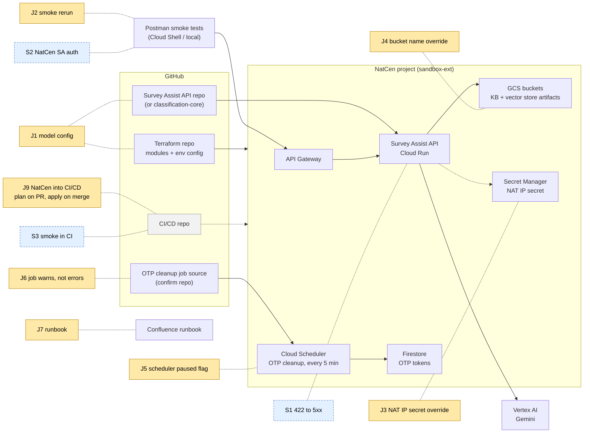

**Order to work in (updated 28 Oct, after the Dan catch-up):** J2 as soon as Dan's Gemini fix lands. **J8 (build once) is your main piece of work.** Then J5 and J6, which are a pair and small. Then J3 and J4. J7 runs alongside, as you discover manual steps.

---

## J1: NatCen: temporary Gemini model, NatCen environment only

| Field | Value |
|---|---|
| **Jira title** | NatCen: make the Gemini model configurable and use the newer Flash model in the NatCen environment only (temporary) |
| **Type** | Task (or Story if the team counts "NatCen can classify" as user-visible value) |
| **Priority** | **P1, highest.** Blocks the NatCen classify endpoints and your smoke test ticket |
| **Assignee** | Joe *(confirm today. Matt asked for the ticket under your item, but nobody was named for the code change.)* |
| **Reviewers** | Rupert / Ethan (Terraform); API code reviewer TBC |
| **Repos** | **Survey Assist API repo**, or wherever the model name is hard-coded (possibly the shared classification-core library, *confirm*). **Terraform repo:** the NatCen env config / Cloud Run env vars |
| **Linked** | Blocks **J2**. Relates to data science evaluation (X2 in the infra sync) and Dan's YAML-to-GCS test image |
| **Decided by** | Matt, refinement 28 Oct. Steve recommended the same version |

### Background
- The API **hard-codes Gemini 2.5 Flash**. Google deprecated it on **20 Oct 2026**, and **new projects can't use it**. The NatCen project is new, so classify fails there (422). Sandbox still works because it's an older project.
- Matt decided to use a **newer Gemini Flash** model (transcribed as "3.8 Flash"; **confirm the exact model ID**) as a **temporary measure in NatCen only**.
- It **must not reach sandbox, dev, pre-prod or prod** until data science has evaluated it.

### What to do
1. Find where the model name is set (search for the 2.5 Flash model ID string in the API and the classification libraries).
2. Read the model name from **configuration** (an environment variable, for example `LLM_MODEL_NAME`; match the existing config naming). **Keep the default at the current 2.5 Flash value**, so every other environment is unchanged.
3. **Log the model name at startup**, so you can see which model each environment runs.
4. In Terraform, add an **optional** Cloud Run env var / variable for the model. Set it **only in the NatCen env config** to the new model ID. Every other environment leaves it unset and plans **"No changes"**.
5. Deploy to NatCen through the NatCen branch build (or the interim CI/CD trigger if T3 is in place).
6. Tell NatCen (via Matt/Dan) that classify runs on a **not-yet-evaluated model**, so the output isn't representative.

### Diagram: model selection per environment

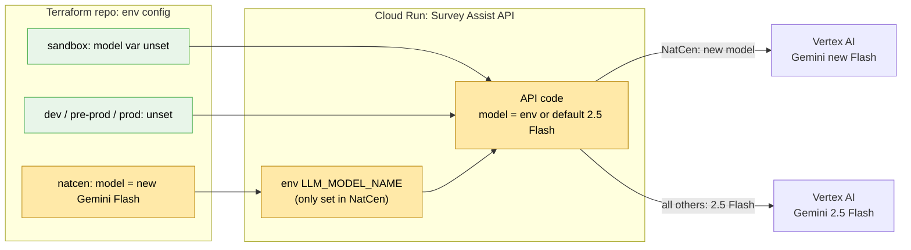

### Acceptance criteria
- [ ] **Given** the NatCen environment, **when** a valid `classify` request is sent through API Gateway, **then** it returns **200** with a classification result (no 422).
- [ ] **Given** sandbox, dev, pre-prod or prod, **when** Terraform is planned with this change, **then** the plan shows **No changes**, and the API still uses **Gemini 2.5 Flash** (confirmed from the startup log in sandbox).
- [ ] The model name is **not hard-coded**: it comes from config with a default of 2.5 Flash, and unit tests cover both "default" and "override".
- [ ] The model in use is **logged at startup**.
- [ ] The exact new model ID is recorded on the ticket and confirmed with data science or Matt.
- [ ] NatCen has been told that classify uses an unevaluated model.
- [ ] Code and Terraform changes are in **separate PRs**, each reviewed and merged.

### Out of scope
- Changing the model in any other environment.
- Model evaluation (data science owns that).

### Open questions
- Exact model ID? Is the model set in the API or in a shared library?
- Does Dan's YAML-to-GCS image change where the model config lives? If the model is set in those YAML files, the override might be a YAML change instead of an env var. **Check with Dan before coding.**

---

## J2: NatCen smoke tests: rerun and close

| Field | Value |
|---|---|
| **Jira title** | NatCen environment: API smoke tests (lookup, classify, store/get result) |
| **Type** | Task *(it's currently a Story; by the team definition it's probably a Task)* |
| **Priority** | P1 |
| **Assignee** | Joe |
| **Action** | **Existing ticket.** Fix it up with Dan's template (labels, sprint). Don't create a new one |
| **Repo / artefacts** | Postman collection [survey-assist-api.postman_collection.json](../postman/survey-assist-api.postman_collection.json), environments [natcen](../postman/survey-assist-natcen.postman_environment.json) / [sandbox](../postman/survey-assist-sandbox.postman_environment.json). Copy goes on Dan's Confluence page |
| **Blocked by** | **J1** (model) and Dan's YAML-to-GCS test image. Possibly the Cisco block (403) on the ONS network |

### Background
- 26 Oct: everything passed **except classify (422)**, caused by the model deprecation.
- 27 Oct: every NatCen call returned **403**. The leading suspect is the ONS Cisco web filter, so you test from **GCP Cloud Shell**.
- 28 Oct: Matt said: rerun once the model change is in, then close the ticket.

### What to do
1. Once J1 and/or Dan's image are deployed, **mint a fresh token** (yesterday's will have expired).
2. Run the collection from **Cloud Shell** (Postman CLI or `newman`) and, separately, from your ONS laptop, so you can tell a Cisco block from a GCP-side problem.
3. Record each endpoint's status code and response body. **Note which change fixed what** (model, YAML config or network).
4. Strip tokens and secrets from the collection and environment, then attach them to Dan's Confluence page.
5. Close the ticket, or raise a follow-up for anything still failing.

### Diagram: smoke test path

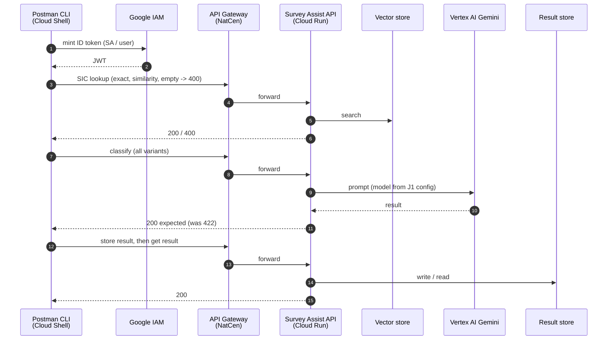

### Acceptance criteria
- [ ] All endpoint groups pass in NatCen: SIC lookup exact, SIC lookup similarity, empty description returns 400, **classify (all variants)**, store result, get result.
- [ ] Results are recorded as a table on the ticket (endpoint, status, date, where it was run from) and compared with sandbox.
- [ ] The root cause of each earlier failure is noted (422 = model; 403 = network or Cisco; YAML config if relevant).
- [ ] The collection and environment template are on Confluence with **no secrets** in them.
- [ ] The ticket has the template labels and sprint, and is closed.

---

## J3: Terraform: NAT IP secret-name override (upstream from NatCen branch)

| Field | Value |
|---|---|
| **Jira title** | Terraform: add an optional override for the NAT IP secret name (no-op for existing environments) |
| **Type** | Task |
| **Priority** | P2 |
| **Assignee** | Joe |
| **Reviewers** | Rupert / Ethan |
| **Repo** | **Terraform repo:** the module that reads or creates the NAT IP secret *(confirm module path)* |
| **Source** | Infra sync 27 Oct (T6), refinement 28 Oct ("tickets for each small change merged one by one") |

### Background
The NatCen branch already uses a different secret name for the NAT IP. To reduce branch drift, upstream it to `main` as an **optional override whose default is the current name**.

### What to do
- Add a variable (for example `nat_ip_secret_name`, default `null`), and use `coalesce(var.nat_ip_secret_name, <current name>)`.
- Set it in the NatCen env config only.
- Remove the NatCen branch's hand-edited version once this is merged.

### Diagram

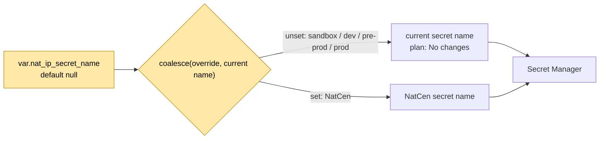

### Acceptance criteria
- [ ] `terraform plan` for sandbox, dev, pre-prod and prod shows **No changes**. Paste the plan output in the PR.
- [ ] The NatCen plan shows the NatCen secret name, with no resource replacement.
- [ ] The variable has a description, and the README or variables docs are updated.
- [ ] The PR is merged to `main` on its own, without other changes.

---

## J4: Terraform: bucket-name override and 63-character guard

| Field | Value |
|---|---|
| **Jira title** | Terraform: optional bucket-name override (or per-env name map) with a 63-character validation |
| **Type** | Task |
| **Priority** | P2 (needed again for the **NatCen prod** environment) |
| **Assignee** | Joe |
| **Reviewers** | Rupert / Ethan |
| **Repo** | **Terraform repo:** storage module and env config *(confirm module path)* |
| **Source** | Infra sync 27 Oct (3.7, T6); refinement 28 Oct mentioned "bucket renaming" as an example |

### Background
Bucket names are built from the project ID. NatCen's longer project ID **breaks GCS's 63-character limit**. The NatCen branch fixed this with a `coalesce` override. Two options were discussed:
- **(a)** the coalesce override (already done in NatCen)
- **(b)** a **map of predefined names per environment** in Terraform

The buckets hold the **knowledge base and vector store artefacts**.

### What to do
- Upstream option (a) to `main` now, default unchanged.
- Add a `validation` block (or a `precondition`) so any generated name over 63 characters **fails at plan time with a clear message**, instead of at apply time.
- On the ticket, record option (b) as a follow-up, and ask Ethan which he prefers before NatCen prod.

### Diagram

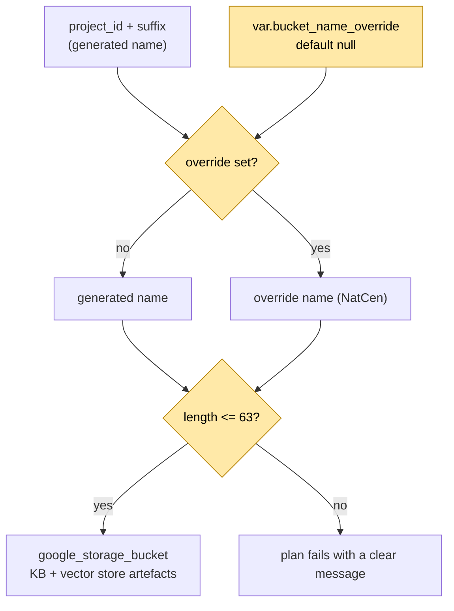

### Acceptance criteria
- [ ] Existing environments plan **No changes**. No bucket is renamed or replaced.
- [ ] The NatCen plan uses the override name, with no replacement.
- [ ] A name over 63 characters **fails at `plan`** with a readable error (tested with a long fake project ID).
- [ ] The map option (b) is noted on the ticket as a follow-up decision before NatCen prod.
- [ ] A single isolated PR is merged to `main`.

---

## J5: Terraform: OTP cleanup job `paused` flag and schedule variable

| Field | Value |
|---|---|
| **Jira title** | Terraform (Firestore OTP module): add `paused` flag and schedule variable to the OTP cleanup Cloud Scheduler job |
| **Type** | Task |
| **Priority** | P2 |
| **Assignee** | Joe |
| **Reviewers** | Ethan / Rupert |
| **Repo** | **Terraform repo:** Firestore OTP module, plus the NatCen env config |
| **Linked** | Pair with **J6** |
| **Source** | Infra sync 27 Oct (3.8, T7); smoke test 27 Oct ("job fails on fresh deploys") |

### Background
- The OTP service manages **UI login codes only**.
- A Cloud Scheduler job runs **every 5 minutes** to delete expired tokens, as a second line of defence.
- NatCen is **API-only**, so it doesn't need the job. Dan **paused it manually**, which Terraform doesn't know about (drift).

### What to do
- Add `var.otp_cleanup_paused` (default `false`) and map it to the scheduler job's `paused` argument.
- Add `var.otp_cleanup_schedule` (default the **current** cron, for example `*/5 * * * *`; *confirm the current value*).
- Set `paused = true` in the NatCen env config, which replaces the manual pause.

### Diagram

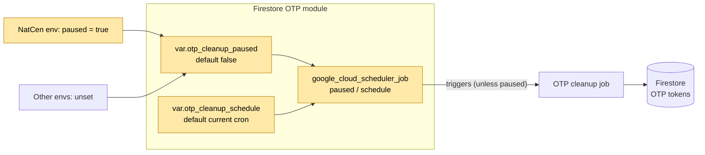

### Acceptance criteria
- [ ] Sandbox, dev, pre-prod and prod plan **No changes**: still running, same schedule.
- [ ] The NatCen plan sets the job to **paused**, and after apply the Cloud Scheduler console shows it paused. A further plan shows no drift.
- [ ] The variables are documented.
- [ ] A single isolated PR is merged to `main`.

---

## J6: OTP cleanup job code: warn instead of error when there are no tokens

| Field | Value |
|---|---|
| **Jira title** | OTP cleanup job: log a warning, not an error, when there are no tokens to delete |
| **Type** | Task (or Bug) |
| **Priority** | P2 |
| **Assignee** | Joe (flagged for you in the 27 Oct smoke test meeting; Dan was going to create a subtask with error messages) |
| **Repo** | **OTP cleanup job source.** Probably alongside the OTP service or UI code *(confirm)* |
| **Linked** | Pair with **J5**. Possibly a subtask Dan has already created, so check before raising a duplicate |

### Background
On a fresh environment with no data, the job **errors** because there are no tokens. That was deliberate during the public test: it doubled as **monitoring**, to detect a wiped database. It was agreed to be over-cautious. It should **warn** when the collection is empty and keep **erroring on a real failure**.

### Diagram

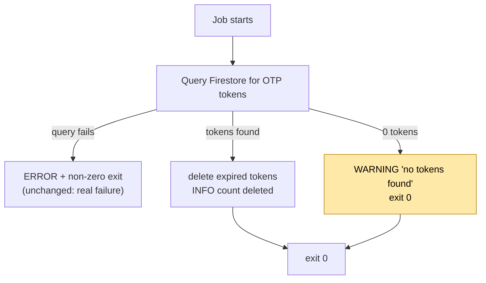

### Acceptance criteria
- [ ] With an empty Firestore collection, the job logs **WARNING** and exits successfully.
- [ ] With expired tokens present, they're deleted and the count is logged.
- [ ] When Firestore is unreachable or the query fails, it still logs **ERROR** and fails, so alerting still works.
- [ ] Unit tests cover all three cases.
- [ ] Confirmed with Ethan whether any alert relied on the old "empty = error" behaviour. Adjust the alert if so.

---

## J7: Runbook: NatCen environment manual steps (shared with Dan)

| Field | Value |
|---|---|
| **Jira title** | Runbook: NatCen environment deployment manual steps and known workarounds |
| **Type** | Task |
| **Priority** | P3 (fill it in as you go) |
| **Assignee** | Joe, with Dan |
| **Location** | **Confluence**: Dan's manual-steps / pain-points page |
| **Source** | Infra sync 27 Oct (T9) |

### What it should cover
- `users.json` provisioning (an empty file is fine for API-only).
- OTP scheduler pause (manual until **J5** lands).
- API Gateway config re-version after first apply (until T5 lands).
- Secret and bucket-name overrides (until **J3** and **J4** land).
- Gemini model override for NatCen (**J1**).
- YAML config files copied to the shared GCS bucket (Dan's image change).
- How to mint a token and run the smoke tests (**J2**).
- Each step marked **"remove when ticket X is merged"**.

### Diagram: deploy process, with manual steps highlighted

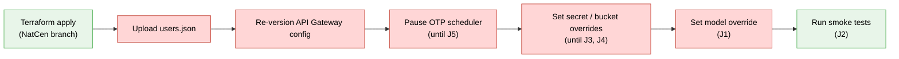

### Acceptance criteria
- [ ] Every manual step has: why it's needed, the exact command or console path, how to verify it, and which ticket removes it.
- [ ] Dan has reviewed it.
- [ ] It's linked from the J1 to J6 tickets.

---

## J9: Integrate NatCen sandbox-ext into the Survey Assist CI/CD pipeline (T1)

| Field | Value |
|---|---|
| **Jira title** | Integrate NatCen Sandbox External into Survey Assist CI/CD pipeline *(as on the board)* |
| **Meeting ID** | **T1** (infra sync 27 Oct, §3.15 / §4.1 / §6.5) |
| **Type** | Story, with one subtask per PR (see "Subtasks") |
| **Epic** | **NatCen** (Dan, catch-up 28 Oct: "the CI/CD one (T1) is NatCen") |
| **Priority** | **P1.** Second DevOps priority after J8 (agreed order: T3 > T1 > T2) |
| **Assignee** | Joe, pairing with Dan *(confirm who leads: the meeting said Dan leads, Joe pairs)* |
| **Reviewers** | Ethan / Rupert |
| **Repos** | **CI/CD repo** (Cloud Build triggers, CI/CD SA, Slack notifier) · **Terraform repo** (env config + backend for `sandbox-ext`) *(confirm whether these are one repo or two)* |
| **Linked** | **Blocked by J3, J4, J5** (and the model config from J1/Dan) being in `main` · relates to **J7** (manual steps it removes or leaves) · relates to **J8** (app image side) · **E4** (least-privilege CI/CD SA, later) |
| **Source** | Infra sync 27 Oct (T1); Dan catch-up 28 Oct |

> **Placeholders.** `<CICD_PROJECT>`, `<REGION>`, `<SANDBOX_EXT_PROJECT>`, `<CICD_SA>` and `<STATE_BUCKET>` weren't said in the meetings. Subtask 1 (discovery) fills them in.

### Background

- **NatCen's environment is the GCP project `sandbox-ext`** ("sandbox external"). It's **deployed and working**, but it was deployed **by hand**: Terraform run from the **NatCen branch** via a **manual trigger + Slack**, plus manual steps (see J7).
- The other environments (sandbox, dev, pre-prod) are already wired into the **Survey Assist CI/CD setup**: Cloud Build in the CI/CD project, running as the **ONS CI/CD service account**.
- In the meeting, the wanted flow is: **raise a PR → `terraform plan` output is posted on the PR (and Slack) → reviewer checks the plan → merge → `terraform apply` runs automatically.**
- Dan's view (§3.15): the **Slack side is already set up**; the main work is a **project-level grant** so the CI/CD SA can reach `sandbox-ext`, and **adding the project to the CI/CD repo setup**.
- **Heads-up (§3.16):** the CI/CD SA is managed by **ONS Platform Engineering** and is effectively **Owner** on every environment. Granting it access to `sandbox-ext` may prompt questions from **ONS Security**. Answer: "same as the existing environments". Least privilege is a separate, later ticket (**E4**).

### Goal

`sandbox-ext` is just another environment in the pipeline. **No manual trigger, no hand-run Terraform.** Every NatCen infra change goes through a reviewed PR with its plan visible.

### Diagram 1: today vs target

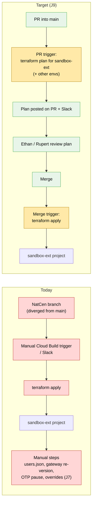

### Diagram 2: PR to apply, step by step

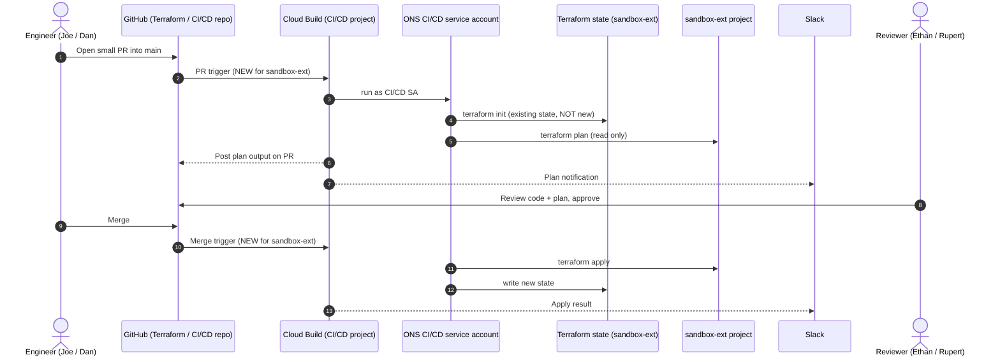

### Diagram 3: what has to be true before the pipeline can plan NatCen cleanly

The pipeline runs Terraform from **`main`**. Today NatCen was applied from the **NatCen branch**. If `main` doesn't yet contain the branch's differences, the first pipeline plan will try to **undo** NatCen's settings. So the branch's differences must be upstreamed first, as no-op PRs.

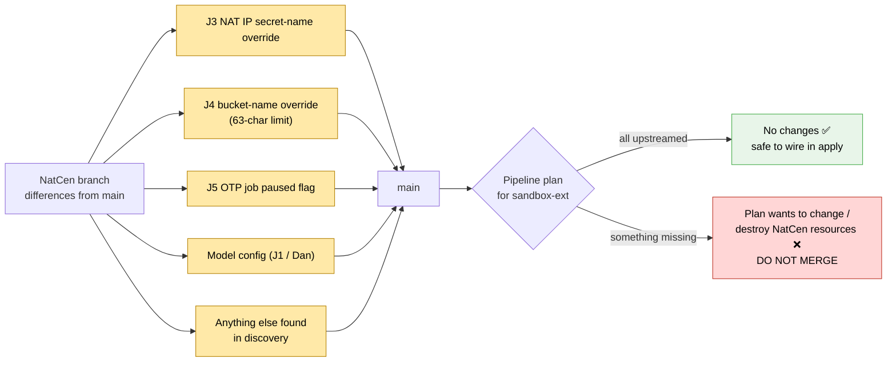

### Diagram 4: access the CI/CD SA needs

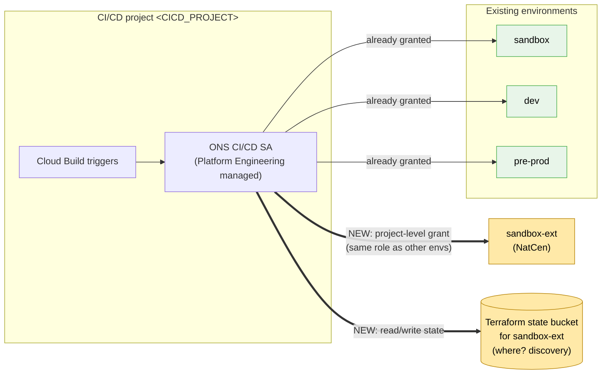

### Subtasks (one PR each)

| # | Subtask | Where | Done when |
|---|---|---|---|
| 1 | **Discovery** (read-only; see checklist below). Fill in the placeholders. | Notes on the ticket | Table below complete. Agreed with Dan where state lives and what's still only on the NatCen branch |
| 2 | **Upstream the NatCen branch differences** into `main` as no-op PRs: **J3, J4, J5**, model config, anything else from discovery | Terraform repo | A local / manual `terraform plan` of `sandbox-ext` **from `main`** shows **No changes** |
| 3 | **Grant the CI/CD SA access** to `sandbox-ext` (project-level, same role as other envs) and to its **state bucket**. Give ONS Security / Platform Engineering a heads-up first | CI/CD repo (IAM) or a Platform Engineering request *(confirm)* | `get-iam-policy` shows the binding |
| 4 | **Add `sandbox-ext` as an environment** in the CI/CD setup: env config / tfvars, backend pointing at the **existing** state | Terraform / CI/CD repo | Config merged. Other envs still plan **No changes** |
| 5 | **PR trigger: plan** for `sandbox-ext`, output posted on the PR and in Slack | CI/CD repo (Cloud Build triggers) | A test PR shows the NatCen plan on the PR and in Slack |
| 6 | **Merge trigger: apply** for `sandbox-ext` | CI/CD repo | Merging a no-op PR runs apply with no manual step, result in Slack |
| 7 | **Retire the manual route**: disable/delete the manual NatCen trigger, update **J7** runbook (which manual steps remain) | CI/CD repo + Confluence | Manual trigger gone. Runbook says "NatCen deploys via PR" |

### Discovery checklist (subtask 1)

| # | Question | How to check |
|---|---|---|
| D1 | How are sandbox/dev/pre-prod wired in? | CI/CD repo: `grep -rn "google_cloudbuild_trigger" .` and look at the env folders / tfvars. `gcloud builds triggers list --project=<CICD_PROJECT> --region=<REGION> --format="table(name,filename,substitutions)"` |
| D2 | **Where is `sandbox-ext`'s Terraform state?** | NatCen branch: the backend config for `sandbox-ext` (`backend.tf` / `-backend-config`). Then `gcloud storage ls gs://<STATE_BUCKET>/` |
| D3 | What's still only on the NatCen branch? | `git diff main...<natcen-branch> --stat` in the Terraform repo |
| D4 | Does the CI/CD SA already have access? | `gcloud projects get-iam-policy <SANDBOX_EXT_PROJECT> --flatten="bindings[].members" --filter="bindings.members:<CICD_SA>" --format="table(bindings.role)"`. Compare with the same command on sandbox |
| D5 | How does the manual trigger work today? | `gcloud builds triggers describe <NATCEN_TRIGGER> --project=<CICD_PROJECT> --region=<REGION>` and the Slack integration |
| D6 | What would `main` do to NatCen right now? | With Dan: `terraform plan` for `sandbox-ext` from `main` (**plan only**). The diff is your upstreaming list for subtask 2 |

| Discovery output | Value |
|---|---|
| `<CICD_PROJECT>` / `<REGION>` | |
| `<SANDBOX_EXT_PROJECT>` (project ID) | |
| `<CICD_SA>` | |
| State bucket + prefix for `sandbox-ext` | |
| Existing NatCen manual trigger name | |
| Branch differences still to upstream | |
| CI/CD SA already has access? | |

### Acceptance criteria
- [ ] **Given** a PR into `main`, **when** the PR trigger runs, **then** `terraform plan` for `sandbox-ext` runs as the CI/CD SA and its output is posted on the PR and in Slack.
- [ ] **Given** a no-op PR, **then** the `sandbox-ext` plan shows **No changes**, and sandbox / dev / pre-prod also show **No changes**.
- [ ] **Given** the PR is merged, **then** `terraform apply` for `sandbox-ext` runs automatically with **no manual step**, and the result is posted in Slack.
- [ ] The pipeline uses the **existing** `sandbox-ext` state (no resources recreated).
- [ ] The manual NatCen trigger is removed or disabled.
- [ ] ONS Security / Platform Engineering were told before the SA grant.
- [ ] J7 runbook updated with which manual steps remain.
- [ ] Each change was its own small PR, reviewed by Ethan or Rupert.

### Risks

| Risk | Mitigation |
|---|---|
| **Pipeline uses new/empty state** and plans to create everything | Discovery D2 first. Point the backend at the existing state. Never merge while the plan shows creates for existing resources |
| **`main` lacks NatCen branch changes**, so the first apply reverts NatCen | Subtask 2 before subtasks 5/6. Keep apply off until the plan is clean |
| **Manual changes in the console** (drift) show up in the first plan | Review the first plan line by line with Dan. Import or codify, don't blindly apply |
| **Plan/apply runs for all envs on every PR** (slow, noisy) | Agree trigger file filters per env *(open question)* |
| **Security questions about the over-permissioned SA** | Heads-up before the grant. Point to E4 for least privilege |
| **NatCen is live for an external partner** | Apply outside NatCen's test windows. Tell NatCen / Dan before the first pipeline apply |

### Out of scope
- **App image build/deploy for NatCen** (that's **J8** subtask 3).
- Removing the remaining manual steps themselves (J5, T5 gateway, users.json): tracked separately, listed in **J7**.
- Least-privilege CI/CD SA (**E4**, later).
- Moving the test proxy (**T2**).

### Open questions (for Dan)
1. Where does `sandbox-ext`'s Terraform state live, and was it last applied from the NatCen branch?
2. Which NatCen branch changes are already in `main`?
3. Are the CI/CD triggers and the Terraform code in the same repo or separate?
4. Who makes the SA grant: us via the CI/CD repo, or a Platform Engineering request? Do we tell Security first?
5. Should the NatCen plan run on every PR, or only when NatCen-related files change?
6. Who leads: Dan (as agreed 27 Oct) or Joe?

---

## Suggested tickets (confirm before raising)

### S1: Bug: upstream model "not found" returns 422
- **Why:** a 422 tells the caller *their* payload is wrong. A missing or deprecated model is a server-side problem and should be **502/503**, with a clear message. NatCen developers would otherwise debug their own requests.
- **Repo:** Survey Assist API repo.
- **Acceptance criteria:**
  - [ ] An LLM provider "model not found" or unavailable error maps to 5xx with a stable error code in the body.
  - [ ] Genuine validation errors still return 422.
  - [ ] Tests cover both.

### S2: Smoke tests: authenticate as NatCen's external service account
- **Why:** today you test with internal credentials. NatCen will use the **external SA** Dan is creating (token creation). Testing that path proves NatCen's access actually works.
- **Repo / artefact:** Postman collection and NatCen environment (a pre-request script that mints the token).
- **Depends on:** Dan's NatCen-only service account.
- **Acceptance criteria:**
  - [ ] Using only the permissions NatCen will have, a token is minted and all smoke tests pass.
  - [ ] No key material is stored in the collection.

### S3: Run the Postman smoke collection automatically after each deploy
- **Why:** today a breaking API change doesn't trigger any end-to-end tests (raised in refinement). A post-deploy smoke run with the Postman CLI catches that cheaply. It fits Dan's central test repo placeholder.
- **Repo:** CI/CD repo (Cloud Build step) or the central test repo if one is created.
- **Acceptance criteria:**
  - [ ] After a deploy to sandbox or NatCen, the collection runs and reports pass/fail to the pipeline and Slack.
  - [ ] Secrets come from Secret Manager, not from the collection.
